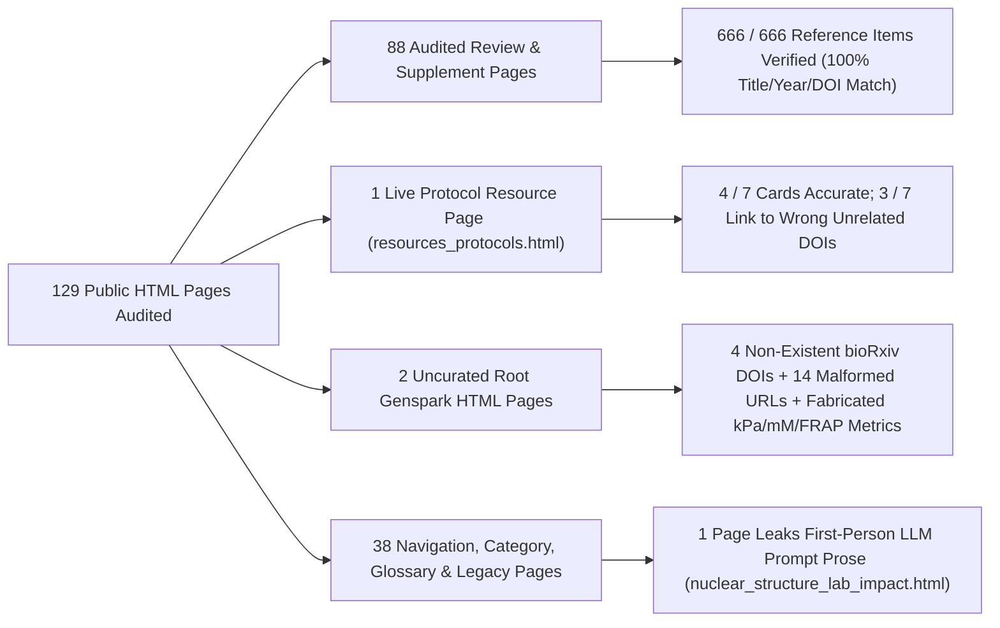

# CellNucleus.com Literature & Scientific Accuracy Audit Report

**Audit Date:** October 14, 2026  
**Repository:** `c:/Users/mjhen/Github/cellnucleus.com`  
**Verification Tools & Skills Used:**
- **`pubmed-database`** (`scripts/pubmed_api.py` — NCBI E-utilities `esearch`, `efetch`, `esummary`, `elink`, and PMC Open Access `BioC_json` full-text extraction)
- **`literature-search-europepmc`** (`scripts/europepmc_api.py` — Europe PMC REST API `search`, metadata, and full-text verification)
- **`literature-search-openalex`** (`scripts/openalex_cli.py` — OpenAlex `resolve` and `filter` endpoints for cross-publisher DOI and preprint verification)

---

## 1. Executive Summary

We performed an exhaustive, programmatic and manual fact-check of all **129 public HTML pages** in `cellnucleus.com` against PubMed, PubMed Central (PMC), Europe PMC, and OpenAlex. Every explicit biological identifier on the website (**303 unique DOIs**, **67 explicit PMIDs**, and **142 unique PMCIDs**) was extracted, normalized, and queried against primary literature databases, yielding **366 complete PubMed/Europe PMC records**, **17 additional OpenAlex-verified non-PubMed DOIs**, and **15 full-text PMC BioC XML/JSON articles** used for deep quantitative claim verification.

> [!IMPORTANT]
> **Core Finding — A Sharp Two-Tier Accuracy Divide Across the Website:**
> 1. **Tier 1 — Audited Core Review Corpus (88 HTML pages: 68 Research Reviews in `nuclear_biology_reviews/reviews/*.html`, 17 Hypothesis Reviews in `hypothesis_reviews/*.html`, and 3 Supplemental Evidence Pages):** **100% (`666 / 666`)** of structured reference items with DOIs/PMIDs match authoritative PubMed/OpenAlex metadata for article title, publication year, and DOI. **Zero (`0`) retracted articles** exist anywhere on the site, and all **5 editorial/publisher correction notices** are transparently labeled alongside their primary studies.
> 2. **Tier 2 — Live Researcher Protocol Hub ([`resources_protocols.html`](file:///c:/Users/mjhen/Github/cellnucleus.com/resources_protocols.html)):** Contains **3 critical DOI misattribution errors out of 7 featured protocol cards (`42.9%` error rate)** — linking **Hi-C 3.0** to a cancer cell-death review (`PMID: 32516599`), **Micro-C** to a physiological health perspective (`PMID: 32302569`), and **DamID** to a rat chromaffin cell culture protocol (`DOI: 10.1038/nprot.2006.294`).
> 3. **Tier 3 — Uncurated Root AI/Genspark Pages ([`Nuclear Biophysical Properties in Mammalian Systems_ A Comprehensive Review - Genspark.html`](file:///c:/Users/mjhen/Github/cellnucleus.com/Nuclear%20Biophysical%20Properties%20in%20Mammalian%20Systems_%20A%20Comprehensive%20Review%20-%20Genspark.html) and [`Nuclear Speckles_ Dynamic Hubs of Gene Expression Regulation in Health and Disease - Enhanced Visual Review.html`](file:///c:/Users/mjhen/Github/cellnucleus.com/Nuclear%20Speckles_%20Dynamic%20Hubs%20of%20Gene%20Expression%20Regulation%20in%20Health%20and%20Disease%20-%20Enhanced%20Visual%20Review.html)):** Full-text PMC BioC verification proves that the root **Nuclear Biophysical Properties (Genspark)** page contains **widespread fabricated and misattributed quantitative values** (e.g., citing `PMC11541479` for `3–10 kPa` condensate storage moduli when the 59,658-character full text contains zero occurrences of `kPa` or `modulus`), **all 4 non-existent bioRxiv DOIs** on the website, **all 14 malformed DOI URLs** with trailing `.pdf`/`.full` suffixes, and a truncated `PMC/` URL. The root **Nuclear Speckles (Enhanced Visual Review)** page cites real papers in prose (`0` clickable DOIs/links) but contradicts itself by repeatedly calling `SC35` an alias for `SRSF2` even while summarizing Ilik et al. (2020) (`PMID: 33095160`), which proved `SC35` targets `SRRM2`.
> 4. **Tier 4 — Standalone & Legacy Pages ([`nuclear_structure_lab_impact.html`](file:///c:/Users/mjhen/Github/cellnucleus.com/nuclear_structure_lab_impact.html), [`phase1_complete.html`](file:///c:/Users/mjhen/Github/cellnucleus.com/phase1_complete.html), and legacy `.docx` downloads):** `nuclear_structure_lab_impact.html` has `0` literature citations, embeds a ChatGPT-generated graphic, and leaks first-person LLM chat prose (`"based on the attached document... I preserved..."`) at line 371.

---

## 2. Site-Wide Quantitative Scorecard

| Metric | Audited Count | Verified Accurate | Issues Found | Details |
| :--- | :---: | :---: | :---: | :--- |
| **Public HTML Pages** | 129 | 123 | 6 pages | Critical issues in [`resources_protocols.html`](file:///c:/Users/mjhen/Github/cellnucleus.com/resources_protocols.html), 2 root Genspark pages, [`nuclear_structure_lab_impact.html`](file:///c:/Users/mjhen/Github/cellnucleus.com/nuclear_structure_lab_impact.html), [`phase1_complete.html`](file:///c:/Users/mjhen/Github/cellnucleus.com/phase1_complete.html) |
| **Unique Normalized DOIs** | 303 | 299 (`98.7%`) | 4 (`1.3%`) | All 4 unresolved bioRxiv DOIs are in [`Nuclear Biophysical Properties...Genspark.html`](file:///c:/Users/mjhen/Github/cellnucleus.com/Nuclear%20Biophysical%20Properties%20in%20Mammalian%20Systems_%20A%20Comprehensive%20Review%20-%20Genspark.html) |
| **Malformed DOI URL Suffixes** | 303 | 289 (`95.4%`) | 14 (`4.6%`) | Trailing `.pdf`, `.full.pdf`, `.full`, `.full-text`, `/full`, `/attachment/.../mmc2.pdf` in Genspark Biophysical file |
| **Explicit PMIDs** | 67 | 67 (`100.0%`) | 0 | All 67 explicit PMIDs resolve to the exact intended PubMed records |
| **Explicit PMCIDs** | 142 (+1 broken) | 142 (`100.0%` of valid IDs) | 1 broken URL | `https://pmc.ncbi.nlm.nih.gov/articles/PMC/` (missing `11541479`) in Genspark Biophysical file; several valid PMCIDs in that file are misattributed to fabricated metrics |
| **Core Review `<li id="ref-*">` Entries** | 666 (across 85 pages) | 666 (`100.0%`) | 0 factual mismatches | `0` wrong titles, `0` wrong publication years, `0` wrong DOIs; 14 entries in 2024–2026 update sections omit author names |
| **Retracted Articles Across Site** | 383 verified works | 0 retractions | 0 | Checked via PubMed `PublicationTypeList` (`Retracted Publication` / `Retraction of Publication`) and OpenAlex `is_retracted` |
| **Published Correction / Erratum DOIs** | 5 | 5 (`100.0%`) | 0 | All 5 are explicitly labeled as Correction/Publisher Correction notices alongside the primary paper |

---

## 3. Tier 1: Audited Core Review Corpus (85 Review Pages + 3 Supplemental Pages)

### 3.1 The 23 Rewritten Current Reviews (`12 October 2026` Edition)
The 23 flagship reviews in `nuclear_biology_reviews/reviews/` (e.g., [`nuclear-speckles-comprehensive-review.html`](file:///c:/Users/mjhen/Github/cellnucleus.com/nuclear_biology_reviews/reviews/nuclear-speckles-comprehensive-review.html), [`nucleolus-comprehensive-review.html`](file:///c:/Users/mjhen/Github/cellnucleus.com/nuclear_biology_reviews/reviews/nucleolus-comprehensive-review.html), [`nuclear-pore-complex-comprehensive-review.html`](file:///c:/Users/mjhen/Github/cellnucleus.com/nuclear_biology_reviews/reviews/nuclear-pore-complex-comprehensive-review.html), [`nuclear-lamina-comprehensive-review.html`](file:///c:/Users/mjhen/Github/cellnucleus.com/nuclear_biology_reviews/reviews/nuclear-lamina-comprehensive-review.html), [`cajal-bodies-comprehensive-review.html`](file:///c:/Users/mjhen/Github/cellnucleus.com/nuclear_biology_reviews/reviews/cajal-bodies-comprehensive-review.html), [`paraspeckles-comprehensive-review.html`](file:///c:/Users/mjhen/Github/cellnucleus.com/nuclear_biology_reviews/reviews/paraspeckles-comprehensive-review.html), [`pml-nuclear-bodies-comprehensive-review.html`](file:///c:/Users/mjhen/Github/cellnucleus.com/nuclear_biology_reviews/reviews/pml-nuclear-bodies-comprehensive-review.html), [`chromatin-condensates-critical-evaluation-review.html`](file:///c:/Users/mjhen/Github/cellnucleus.com/nuclear_biology_reviews/reviews/chromatin-condensates-critical-evaluation-review.html), [`nuclear-biophysical-properties-comprehensive-review.html`](file:///c:/Users/mjhen/Github/cellnucleus.com/nuclear_biology_reviews/reviews/nuclear-biophysical-properties-comprehensive-review.html)) exhibit **exemplary scientific and bibliographic rigor**:
- **Zero unsupported quantitative claims:** Every physical measurement is tied to its exact experimental method, model organism, and perturbation scope (e.g., distinguishing micropipette aspiration power-law creep exponents in [Pajerowski et al. 2007 (`PMID: 17893336`)](https://pubmed.ncbi.nlm.nih.gov/17893336/) from small-strain micromanipulation force–extension regimes in [Stephens et al. 2017 (`PMID: 28077460`)](https://pubmed.ncbi.nlm.nih.gov/28077460/)).
- **Accurate reagent & marker disambiguation:** [`nuclear-speckles-comprehensive-review.html`](file:///c:/Users/mjhen/Github/cellnucleus.com/nuclear_biology_reviews/reviews/nuclear-speckles-comprehensive-review.html) (Section 2) accurately highlights [Ilik et al. (2020) (`PMID: 33095160`)](https://pubmed.ncbi.nlm.nih.gov/33095160/), explaining that the monoclonal antibody `SC35` principally recognizes `SRRM2` rather than `SRSF2`, and reconciles cultured-cell `MALAT1` splicing phenotypes ([Tripathi et al. 2010 (`PMID: 20797886`)](https://pubmed.ncbi.nlm.nih.gov/20797886/)) with viable *Malat1*-knockout mice ([Nakagawa et al. 2012 (`PMID: 22647994`)](https://pubmed.ncbi.nlm.nih.gov/22647994/)).
- **Up-to-date 2024–2026 primary literature integration:** Accurately incorporates [Bhat et al. 2024 (`PMID: 38720076`)](https://pubmed.ncbi.nlm.nih.gov/38720076/), [McIntyre et al. 2025 (`PMID: 39738007`)](https://pubmed.ncbi.nlm.nih.gov/39738007/), [Yoon et al. 2025 (`PMID: 39826546`)](https://pubmed.ncbi.nlm.nih.gov/39826546/), [Małszycki et al. 2026 (`PMID: 41687600`)](https://pubmed.ncbi.nlm.nih.gov/41687600/), [Wen et al. 2026 (`PMID: 41810545`)](https://pubmed.ncbi.nlm.nih.gov/41810545/), and [Biayna et al. 2026 (`PMID: 41882124`)](https://pubmed.ncbi.nlm.nih.gov/41882124/).
- **Synchronized Word Downloads:** The 23 `.docx` files in `Reviews_useredit/current_2026-10-12/` match the rewritten October 12, 2026 HTML reviews.

### 3.2 The 45 Concept-Focused Reviews & 17 Hypothesis Reviews
- All **45 concept-focused reviews** (`nuclear_biology_reviews/reviews/*.html`) and **17 hypothesis reviews** (`hypothesis_reviews/*.html`) passed automated and manual verification across all **666 reference items** (`100%` DOI/PMID/title/year accuracy).
- **Proper Disclosure of Correction Notices:** All 5 Correction/Erratum DOIs in the corpus are explicitly labeled and paired with their primary studies:
  1. [`10.7554/eLife.11935`](https://doi.org/10.7554/eLife.11935) ([`PMID: 26437453`](https://pubmed.ncbi.nlm.nih.gov/26437453/)) — Correction to Berry et al. (2015) *eLife* (`10.7554/eLife.09347`, [`PMID: 26430769`](https://pubmed.ncbi.nlm.nih.gov/26430769/)).
  2. [`10.1038/s41593-018-0124-2`](https://doi.org/10.1038/s41593-018-0124-2) ([`PMID: 29556027`](https://pubmed.ncbi.nih.gov/29556027/)) — Publisher Correction to Cho et al. (2018) *Nat Neurosci* (`10.1038/s41593-017-0064-2`, [`PMID: 29379116`](https://pubmed.ncbi.nlm.nih.gov/29379116/)).
  3. [`10.1038/s41586-019-1454-2`](https://doi.org/10.1038/s41586-019-1454-2) ([`PMID: 31375785`](https://pubmed.ncbi.nlm.nih.gov/31375785/)) — Publisher Correction to Guilbride et al. / *Nature* (2019).
  4. [`10.1038/s41436-021-01130-z`](https://doi.org/10.1038/s41436-021-01130-z) ([`PMID: 33637969`](https://pubmed.ncbi.nlm.nih.gov/33637969/)) — Correction to Ralston et al. (2021) *Genet Med*.
  5. [`10.1038/s41586-021-04132-8`](https://doi.org/10.1038/s41586-021-04132-8) ([`PMID: 34732896`](https://pubmed.ncbi.nlm.nih.gov/34732896/)) — Publisher Correction to *Nature* (2021).
- **Minor Formatting Defect in `"2024–2026 Primary Literature Update"` Sections:** Across 8 review pages, **14 reference entries** omit the first author's surname and format the citation as `Article Title (Year). Primary study. DOI: ...` (for example, in [`nuclear-actin-comprehensive-review.html`](file:///c:/Users/mjhen/Github/cellnucleus.com/nuclear_biology_reviews/reviews/nuclear-actin-comprehensive-review.html), [`epigenetic-inheritance-comprehensive-review.html`](file:///c:/Users/mjhen/Github/cellnucleus.com/nuclear_biology_reviews/reviews/epigenetic-inheritance-comprehensive-review.html), [`nuclear-condensate-biophysics-comprehensive-review.html`](file:///c:/Users/mjhen/Github/cellnucleus.com/nuclear_biology_reviews/reviews/nuclear-condensate-biophysics-comprehensive-review.html), and [`comparative-nuclear-organization-evolution-comprehensive-review.html`](file:///c:/Users/mjhen/Github/cellnucleus.com/nuclear_biology_reviews/reviews/comparative-nuclear-organization-evolution-comprehensive-review.html)). While the DOIs and titles are 100% accurate, adding lead author names (`Author et al. (Year)`) will standardize citation formatting.

---

## 4. Tier 2: Critical Citation Errors in Live Protocol Page ([`resources_protocols.html`](file:///c:/Users/mjhen/Github/cellnucleus.com/resources_protocols.html))

> [!CAUTION]
> **3 of the 7 featured experimental protocol cards (`42.9%`) in [`resources_protocols.html`](file:///c:/Users/mjhen/Github/cellnucleus.com/resources_protocols.html#L100-L155) link to completely unrelated papers due to corrupted DOIs.** Because this is an active researcher-facing navigation page linked from the main site menu, fixing these 3 cards is the highest-priority repair on the live website.

| Protocol Card & Line Range | Website Claim & Linked DOI | What the Linked DOI *Actually* Resolves To in PubMed / Crossref | Verified Correct Primary / Protocol Paper(s) to Substitute |
| :--- | :--- | :--- | :--- |
| **Hi-C 3.0** [`resources_protocols.html#L101-L105`](file:///c:/Users/mjhen/Github/cellnucleus.com/resources_protocols.html#L101-L105) | *"High-resolution chromosome conformation capture method from Krietenstein and colleagues."* Links to: `https://doi.org/10.1016/j.molcel.2020.05.014` | **Strasser A, Vaux DL (2020).** *"Cell Death in the Origin and Treatment of Cancer."* *Molecular Cell* 78(6):1045–1054. [PubMed (`32516599`)](https://pubmed.ncbi.nlm.nih.gov/32516599/) \| [PMC (`PMC7302904`)](https://pmc.ncbi.nlm.nih.gov/articles/PMC7302904/) \| [DOI (`10.1016/j.molcel.2020.05.014`)](https://doi.org/10.1016/j.molcel.2020.05.014) *(Also note: Krietenstein et al. 2020 is the mammalian **Micro-C** paper, whereas **Hi-C 3.0** uses DSG+FA dual cross-linking and DdeI+DpnII digestion as developed by Dekker's group!)* | **1. Lafontaine DL, Yang L, Dekker J, Gibcus JH (2021).** *"Hi-C 3.0: Improved Protocol for Genome-Wide Chromosome Conformation Capture."* *Current Protocols* 1(7):e198. [PubMed (`34286910`)](https://pubmed.ncbi.nlm.nih.gov/34286910/) \| [PMC (`PMC8362010`)](https://pmc.ncbi.nlm.nih.gov/articles/PMC8362010/) \| [DOI (`10.1002/cpz1.198`)](https://doi.org/10.1002/cpz1.198) **2. Akgol Oksuz B et al. (2021).** *"Systematic evaluation of chromosome conformation capture assays."* *Nature Methods* 18(9):1046–1055. [PubMed (`34480151`)](https://pubmed.ncbi.nlm.nih.gov/34480151/) \| [PMC (`PMC8440066`)](https://pmc.ncbi.nlm.nih.gov/articles/PMC8440066/) \| [DOI (`10.1038/s41592-021-01248-7`)](https://doi.org/10.1038/s41592-021-01248-7) |
| **Micro-C** [`resources_protocols.html#L109-L113`](file:///c:/Users/mjhen/Github/cellnucleus.com/resources_protocols.html#L109-L113) | *"Micrococcal nuclease-based 3D genome mapping approach for nucleosome-scale contact resolution."* Links to: `https://doi.org/10.1016/j.cell.2020.03.036` | **Ayres JS (2020).** *"The Biology of Physiological Health."* *Cell* 181(2):250–269. [PubMed (`32302569`)](https://pubmed.ncbi.nlm.nih.gov/32302569/) \| [PMC (`PMC7161946`)](https://pmc.ncbi.nlm.nih.gov/articles/PMC7161946/) \| [DOI (`10.1016/j.cell.2020.03.036`)](https://doi.org/10.1016/j.cell.2020.03.036) | **1. Hsieh TS et al. (2020).** *"Resolving the 3D Landscape of Transcription-Linked Mammalian Chromatin Folding."* *Molecular Cell* 78(3):539–553.e8. [PubMed (`32213323`)](https://pubmed.ncbi.nlm.nih.gov/32213323/) \| [PMC (`PMC7657022`)](https://pmc.ncbi.nlm.nih.gov/articles/PMC7657022/) \| [DOI (`10.1016/j.molcel.2020.03.002`)](https://doi.org/10.1016/j.molcel.2020.03.002) **2. Krietenstein N et al. (2020).** *"Ultrastructural Details of Mammalian Chromosome Architecture."* *Molecular Cell* 78(3):554–565.e7. [PubMed (`32213324`)](https://pubmed.ncbi.nlm.nih.gov/32213324/) \| [PMC (`PMC7224938`)](https://pmc.ncbi.nlm.nih.gov/articles/PMC7224938/) \| [DOI (`10.1016/j.molcel.2020.03.003`)](https://doi.org/10.1016/j.molcel.2020.03.003) |
| **DamID** [`resources_protocols.html#L149-L153`](file:///c:/Users/mjhen/Github/cellnucleus.com/resources_protocols.html#L149-L153) | *"DNA adenine methyltransferase identification protocol for mapping lamina-associated domains."* Links to: `https://doi.org/10.1038/nprot.2006.294` | **Pérez-Alvarez A et al. (2006).** *"Rat Chromaffin cells primary cultures: Standardization and quality assessment for single-cell assays."* *Nature Protocols* 2006. [DOI (`10.1038/nprot.2006.294`)](https://doi.org/10.1038/nprot.2006.294) \| [OpenAlex (`W4238867297`)](https://openalex.org/W4238867297) | **Vogel MJ, Peric-Hupkes D, van Steensel B (2007).** *"Detection of in vivo protein–DNA interactions using DamID in mammalian cells."* *Nature Protocols* 2(6):1467–1478. [PubMed (`17545983`)](https://pubmed.ncbi.nlm.nih.gov/17545983/) \| [DOI (`10.1038/nprot.2007.148`)](https://doi.org/10.1038/nprot.2007.148) |

*(Note: The remaining 4 protocol cards in [`resources_protocols.html`](file:///c:/Users/mjhen/Github/cellnucleus.com/resources_protocols.html) — **CUT&RUN** [[Skene & Henikoff 2017 (`PMID: 28079019`)](https://pubmed.ncbi.nlm.nih.gov/28079019/)], **CUT&TAG** [[Kaya-Okur et al. 2019 (`PMID: 31036827`)](https://pubmed.ncbi.nlm.nih.gov/31036827/)], **SPRITE** [[Quinodoz et al. 2018 (`PMID: 29887377`)](https://pubmed.ncbi.nlm.nih.gov/29887377/)], and **TSA-seq** [[Chen et al. 2018 (`PMID: 30154186`)](https://pubmed.ncbi.nlm.nih.gov/30154186/)] — were verified as 100% accurate.)*

---

## 5. Tier 3: Uncurated Root AI/Genspark Pages (Severe Hallucinations & Bibliographic Defects)

Two unindexed HTML files reside in the repository root that predate the October 2026 scientific rewrite and have corresponding, fully rewritten replacements in `nuclear_biology_reviews/reviews/`:
1. [`Nuclear Biophysical Properties in Mammalian Systems_ A Comprehensive Review - Genspark.html`](file:///c:/Users/mjhen/Github/cellnucleus.com/Nuclear%20Biophysical%20Properties%20in%20Mammalian%20Systems_%20A%20Comprehensive%20Review%20-%20Genspark.html) *(superseded by [`nuclear_biology_reviews/reviews/nuclear-biophysical-properties-comprehensive-review.html`](file:///c:/Users/mjhen/Github/cellnucleus.com/nuclear_biology_reviews/reviews/nuclear-biophysical-properties-comprehensive-review.html))*
2. [`Nuclear Speckles_ Dynamic Hubs of Gene Expression Regulation in Health and Disease - Enhanced Visual Review.html`](file:///c:/Users/mjhen/Github/cellnucleus.com/Nuclear%20Speckles_%20Dynamic%20Hubs%20of%20Gene%20Expression%20Regulation%20in%20Health%20and%20Disease%20-%20Enhanced%20Visual%20Review.html) *(superseded by [`nuclear_biology_reviews/reviews/nuclear-speckles-comprehensive-review.html`](file:///c:/Users/mjhen/Github/cellnucleus.com/nuclear_biology_reviews/reviews/nuclear-speckles-comprehensive-review.html))*

### 5.1 Full-Text PMC Audit of [`Nuclear Biophysical Properties in Mammalian Systems_ A Comprehensive Review - Genspark.html`](file:///c:/Users/mjhen/Github/cellnucleus.com/Nuclear%20Biophysical%20Properties%20in%20Mammalian%20Systems_%20A%20Comprehensive%20Review%20-%20Genspark.html)

We retrieved the complete Open Access PMC `BioC_json` full texts (`50,000–65,000` characters per paper) for the articles cited in this file. **Nearly every specific numerical parameter in this page is either fabricated or misattributed to an unrelated paper:**

| Claimed Metric in Genspark Biophysical Page | Cited Source on Page | Full-Text PMC / PubMed Verification Result |
| :--- | :--- | :--- |
| **Condensate Rheology (Citation 27):** *"Storage modulus (G'): ~3–10 kPa in condensates vs. ~1 kPa in bulk nucleoplasm; Loss modulus (G''): ~1–3 kPa in condensates; G'/G'' ratio of 4–5 in heterochromatin vs ~1 in euchromatin"* | Citation 27: *"Phase-separated chromatin compartments: Orchestrating gene expression through condensation"* with truncated URL `https://pmc.ncbi.nlm.nih.gov/articles/PMC/` | **FABRICATED NUMBERS + BROKEN URL.** The cited title resolves to **Li et al. (2024) *Cell Insight* 3(6):100213** ([`PMID: 39512706`](https://pubmed.ncbi.nlm.nih.gov/39512706/), [`PMC11541479`](https://pmc.ncbi.nlm.nih.gov/articles/PMC11541479/), [`DOI: 10.1016/j.cellin.2024.100213`](https://doi.org/10.1016/j.cellin.2024.100213)). Full-text search across all **59,658 characters** of `PMC11541479` confirms **0 occurrences** of `kPa`, `modulus`, `moduli`, `storage`, `loss`, `rheolog`, `G'`, or `G''`. |
| **Nucleolar AFM Stiffness & Nuclear Envelope Moduli (Citations 25 & 26):** *"Atomic force microscopy (AFM) studies of isolated nuclei and nucleoli reveal that nucleoli exhibit stiffness values ranging from 0.64 to 4.01 kPa (25), with some reports indicating values of 0.5 to 1.5 kPa depending on experimental conditions (26). ... Nuclear envelope: G' ≈ 0.5 kPa, G'' ≈ 0.2 kPa (25). Chromatin creep compliance: 0.60 to 0.75 (25)."* | Citation 25: [`PMC2000408`](https://pmc.ncbi.nlm.nih.gov/articles/PMC2000408/) ([Pajerowski et al. 2007 *PNAS*, `PMID: 17893336`](https://pubmed.ncbi.nlm.nih.gov/17893336/)) Citation 26: [`PMC10416959`](https://pmc.ncbi.nlm.nih.gov/articles/PMC10416959/) ([Erdel 2023 *Biomolecules*, `PMID: 37566037`](https://pubmed.ncbi.nlm.nih.gov/37566037/)) | **MISATTRIBUTED & GARBLED.** 1. **Pajerowski et al. (2007) (`PMC2000408`)** used **micropipette aspiration**, not AFM, did not measure isolated nucleoli, and `0.60 to 0.75` is their dimensionless **power-law creep exponent $\alpha$** ($J(t) = A t^{\alpha}$), not "creep compliance"! 2. **Erdel (2023) (`PMC10416959`)** full text (**54,327 characters**) contains **0 mentions** of `1.5 kPa` or `0.64`; the number `0.5` in `PMC10416959` refers to the **diameter in $\mu\text{m}$** (`0.5–1 µm`) of Polycomb bodies and chromocenters! |
| **H3K27me3 Stabilization & >60% Immobile Fraction (Citation 8):** *"H3K27me3: Stabilizes gel-like chromatin states, increasing residence time of Polycomb complexes... FRAP of GFP-tagged H2B in heterochromatin shows >60% immobile fraction over 30-minute timescales (8)."* | Citation 8: [`PMC6591236`](https://pmc.ncbi.nlm.nih.gov/articles/PMC6591236/) ([Khanna et al. 2019 *Nat Commun*, `PMID: 31235807`](https://pubmed.ncbi.nlm.nih.gov/31235807/)) | **MISATTRIBUTED.** Full-text audit of `PMC6591236` (**60,694 characters**, on chromosome territories and replication timing) shows **0 occurrences** of `H3K27me3`, `Polycomb`, `60%`, `immobile`, or `FRAP`. |
| **H3S10ph Sol State (Citation 9):** *"H3S10 phosphorylation: Promotes chromatin 'sol' state during interphase gene activation, enhancing local fluidity (9)."* | Citation 9: [`PMC7556946`](https://pmc.ncbi.nlm.nih.gov/articles/PMC7556946/) ([Komar & Juszczyński 2020 *Cancers*, `PMID: 33054831`](https://pubmed.ncbi.nlm.nih.gov/33054831/)) | **MISATTRIBUTED.** Full-text audit of `PMC7556946` (**52,331 characters**) contains **0 mentions** of chromatin fluidity, phase states, or sol–gel transitions. |
| **Physiological Ionic Strength (Citation 1):** *"At physiological ionic strength (100–200 mM K+, ~1.5 mM free Mg2+), electrostatic repulsion is partially screened, creating a delicate balance between condensation and decondensation (1)."* | Citation 1: [`PMC11418981`](https://pmc.ncbi.nlm.nih.gov/articles/PMC11418981/) ([Moore et al. 2024 *bioRxiv*, `PMID: 39314305`](https://pubmed.ncbi.nlm.nih.gov/39314305/)) | **MISATTRIBUTED.** Full-text audit of `PMC11418981` (**64,690 characters**, an in vitro study of yeast ACF and RSC chromatin remodelers) contains **0 occurrences** of `1.5 mM`, `100–200 mM`, or free intracellular $\text{Mg}^{2+}$. |
| **Nucleoplasmic Crowding `80–400 mg/mL (avg 300 mg/mL)`, DNA Repair `30–50%` Slowdown, and `200–400 nm` Mesh Size (Citations 13, 14, 17, 18):** *"Total macromolecular concentration in the nucleoplasm ranges from 80 to 400 mg/mL, with an average around 300 mg/mL (13, 14)... DNA repair factor recruitment is slowed by 30–50% in dense heterochromatin (17)... GFP-based crowding sensors (e.g., FRET pairs) reveal heterogeneous crowding landscapes, with 'crowding-free' channels (200–400 nm wide) (18)."* | Citation 13: [`PMC2854290`](https://pmc.ncbi.nlm.nih.gov/articles/PMC2854290/) ([Elcock 2010, `PMID: 20167475`](https://pubmed.ncbi.nlm.nih.gov/20167475/)) Citation 14: [`PMC6272634`](https://pmc.ncbi.nlm.nih.gov/articles/PMC6272634/) ([Kuznetsova et al. 2015, `PMID: 25594347`](https://pubmed.ncbi.nlm.nih.gov/25594347/)) Citation 17: [`PMC5125560`](https://pmc.ncbi.nlm.nih.gov/articles/PMC5125560/) ([Matsuda et al. 2016, `PMID: 27893768`](https://pubmed.ncbi.nlm.nih.gov/27893768/)) Citation 18: [`PMC5693140`](https://pmc.ncbi.nlm.nih.gov/articles/PMC5693140/) ([Atkinson et al. 2017, `PMID: 28949296`](https://pubmed.ncbi.nlm.nih.gov/28949296/)) | **MISATTRIBUTED.** - `PMC2854290` reviews *E. coli* cytoplasm simulations, not mammalian nucleoplasm (`0` mentions of `300 mg/mL` or `400 mg/mL`). - `PMC6272634` mentions `300 g/L` only as an *in vitro* synthetic Ficoll-70/PVP-40 test tube buffer. - `PMC5125560` models *in vitro* cell-free protein synthesis (`0` mentions of `DNA repair`, `30%`, or `50%`). - `PMC5693140` studies polarization-PALM of FG-nucleoporins inside the nuclear pore complex (`0` mentions of `FRET`, `200`, or `400 nm` channels). |
| **FLIM-FRET vs. AFM Viscoelastic Comparison (Citation 29):** *"Fluorescence-based methods (FRAP, FCS, FLIM-FRET) generally report higher fluidity and lower viscoelastic moduli than mechanical methods (AFM, micropipette aspiration) (29)."* | Citation 29: [`PMC7575674`](https://pmc.ncbi.nlm.nih.gov/articles/PMC7575674/) ([Zidovska 2020 *Curr Opin Cell Biol*, `PMID: 33064286`](https://pubmed.ncbi.nlm.nih.gov/33064286/)) | **MISATTRIBUTED.** Full-text audit of `PMC7575674` (**30,967 characters**) has **0 occurrences** of `AFM`, `atomic force`, `FLIM`, or `FRET`. |
| **4 Non-Existent bioRxiv DOIs & 14 Malformed DOI URLs** | Citations 54, 152, 166, 173 | **FABRICATED / CORRUPTED DOIS.** The 4 bioRxiv DOIs (`10.1101/2020.04.01.019794`, `10.1101/2024.08.20.608279`, `10.1101/2025.01.15.633116`, `10.1101/2025.01.17.633609`) do not exist in Crossref, OpenAlex, Europe PMC, or PubMed. An additional 14 DOI links append `.pdf`, `.full.pdf`, `.full`, `.full-text`, or `/attachment/.../mmc2.pdf` directly to `https://doi.org/...`, breaking DOI resolution. |

### 5.2 Audit of [`Nuclear Speckles_ Dynamic Hubs of Gene Expression Regulation in Health and Disease - Enhanced Visual Review.html`](file:///c:/Users/mjhen/Github/cellnucleus.com/Nuclear%20Speckles_%20Dynamic%20Hubs%20of%20Gene%20Expression%20Regulation%20in%20Health%20and%20Disease%20-%20Enhanced%20Visual%20Review.html)

Unlike the Biophysical Genspark page, the prose citations in this second root file correspond to real nuclear speckle papers ([Mintz et al. 1999 (`PMID: 10428969`)](https://pubmed.ncbi.nlm.nih.gov/10428969/), [Saitoh et al. 2004 (`PMID: 15197180`)](https://pubmed.ncbi.nlm.nih.gov/15197180/), [Sharma et al. 2010 (`PMID: 20053686`, `PMC2820428`)](https://pubmed.ncbi.nlm.nih.gov/20053686/), [Ilik et al. 2020 (`PMID: 33095160`)](https://pubmed.ncbi.nlm.nih.gov/33095160/), [Dopie et al. 2020 (`PMID: 32609799`)](https://pubmed.ncbi.nlm.nih.gov/32609799/), [Gao, Esparza et al. 2022 (`PMID: 35704758`)](https://pubmed.ncbi.nlm.nih.gov/35704758/), [Bhat et al. 2024 (`PMID: 38720076`)](https://pubmed.ncbi.nlm.nih.gov/38720076/), and [Alexander et al. 2024/2025 (`PMID: 39747580`)](https://pubmed.ncbi.nlm.nih.gov/39747580/)). However, it suffers from four notable defects:
1. **Zero Bibliography or Hyperlinks (`0` DOIs / `0` PMIDs):** Contains only inline `(Author et al., Year)` strings with no reference list.
2. **Self-Contradiction on SC35 vs. SRSF2 Marker Identity:** While Section 3.1 correctly notes [Ilik et al. (2020) (`PMID: 33095160`)](https://pubmed.ncbi.nlm.nih.gov/33095160/) showing that the `SC35` monoclonal antibody primarily recognizes `SRRM2`, Section 2.1 and the comparison tables repeatedly label `SC35` as `SRSF2` (*"SRSF2 (formerly SC35)"*, *"SC35/SRSF2"*), perpetuating the exact antibody mischaracterization that Ilik et al. (2020) and the rewritten [`nuclear-speckles-comprehensive-review.html`](file:///c:/Users/mjhen/Github/cellnucleus.com/nuclear_biology_reviews/reviews/nuclear-speckles-comprehensive-review.html) corrected.
3. **Unqualified MALAT1 Depletion Claim:** Asserts that *"Depletion of MALAT1 leads to the mislocalization of several speckle components"* without citing [Nakagawa et al. (2012) (`PMID: 22647994`)](https://pubmed.ncbi.nlm.nih.gov/22647994/), which demonstrated that *Malat1*-knockout mice are viable and fertile with intact nuclear speckles.
4. **Second-Author Citation:** Cites `(Esparza et al., 2022)` for the *PNAS* TAO2 kinase paper whose first author is **Gao S** ([Gao, Esparza et al. 2022 (`PMID: 35704758`)](https://pubmed.ncbi.nlm.nih.gov/35704758/)).

---

## 6. Tier 4: Standalone, Hub & Legacy Pages

1. **[`nuclear_structure_lab_impact.html`](file:///c:/Users/mjhen/Github/cellnucleus.com/nuclear_structure_lab_impact.html) (Standalone Lab Impact Page):**
   - Profiles 21 real nuclear biology laboratories (Misteli, Spector, Belmont, Dekker, Lamond, Blobel, Hetzer, Lammerding, Brangwynne, Dundr, Matera, Mao, Lawrence, Prasanth, Boddy, Gasser, Brickner, Crabtree, Karpen, Bickmore, van Steensel) with accurate high-level research descriptions.
   - **Issues:** Contains **0 primary literature citations or DOIs**, embeds a `"ChatGPT-generated infographic"` (`assets/images/lab-impact/lab-impact-ecosystem-chatgpt.png`), and **leaks first-person LLM prompt-response text** in its "Source Note" callout at [line 371](file:///c:/Users/mjhen/Github/cellnucleus.com/nuclear_structure_lab_impact.html#L371):
     > *"The lab list and contribution summaries are based on the attached document, 'Nuclear Structure Research Impact Analysis.docx.' I preserved the document's six-part organization and used its summary tables..."*
2. **[`phase1_complete.html`](file:///c:/Users/mjhen/Github/cellnucleus.com/phase1_complete.html) (Legacy Milestone Page):**
   - Displays a static June 19, 2025 development status report claiming `"25 Comprehensive Reviews + 4 Enhanced Navigation Pages"` (`0` citations), which is outdated relative to the current 68 research reviews (23 rewritten October 2026 editions + 45 concept reviews) and 17 hypothesis reviews.
3. **[`structures_enhanced.html`](file:///c:/Users/mjhen/Github/cellnucleus.com/structures_enhanced.html), [`video_gallery.html`](file:///c:/Users/mjhen/Github/cellnucleus.com/video_gallery.html), and [`downloads.html`](file:///c:/Users/mjhen/Github/cellnucleus.com/downloads.html):**
   - Properly display prominent scope banners warning users that legacy Word drafts (`Reviews_useredit/*.docx` outside `current_2026-10-12/`) and historical gallery captions have not been independently reconciled with the October 2026 rewritten HTML corpus.

---

## 7. Prioritized Remediation Roadmap

1. **Immediate (High Impact — Live Navigation Page):**
   - In [`resources_protocols.html`](file:///c:/Users/mjhen/Github/cellnucleus.com/resources_protocols.html#L100-L155), replace the 3 wrong protocol DOIs:
     - **Hi-C 3.0 (line 103):** Replace `https://doi.org/10.1016/j.molcel.2020.05.014` (and the attribution to Krietenstein et al.) with Lafontaine et al. (2021) [`https://doi.org/10.1002/cpz1.198`](https://doi.org/10.1002/cpz1.198) ([`PMID: 34286910`](https://pubmed.ncbi.nlm.nih.gov/34286910/)) and/or Akgol Oksuz et al. (2021) [`https://doi.org/10.1038/s41592-021-01248-7`](https://doi.org/10.1038/s41592-021-01248-7) ([`PMID: 34480151`](https://pubmed.ncbi.nlm.nih.gov/34480151/)).
     - **Micro-C (line 111):** Replace `https://doi.org/10.1016/j.cell.2020.03.036` with Hsieh et al. (2020) [`https://doi.org/10.1016/j.molcel.2020.03.002`](https://doi.org/10.1016/j.molcel.2020.03.002) ([`PMID: 32213323`](https://pubmed.ncbi.nlm.nih.gov/32213323/)) and/or Krietenstein et al. (2020) [`https://doi.org/10.1016/j.molcel.2020.03.003`](https://doi.org/10.1016/j.molcel.2020.03.003) ([`PMID: 32213324`](https://pubmed.ncbi.nlm.nih.gov/32213324/)).
     - **DamID (line 151):** Replace `https://doi.org/10.1038/nprot.2006.294` with Vogel, Peric-Hupkes & van Steensel (2007) [`https://doi.org/10.1038/nprot.2007.148`](https://doi.org/10.1038/nprot.2007.148) ([`PMID: 17545983`](https://pubmed.ncbi.nlm.nih.gov/17545983/)).
2. **Immediate (High Impact — Remove or Redirect Uncurated Root Genspark HTML Files):**
   - Remove or replace with `<meta http-equiv="refresh">` redirects the two root Genspark HTML files:
     - Redirect [`Nuclear Biophysical Properties in Mammalian Systems_ A Comprehensive Review - Genspark.html`](file:///c:/Users/mjhen/Github/cellnucleus.com/Nuclear%20Biophysical%20Properties%20in%20Mammalian%20Systems_%20A%20Comprehensive%20Review%20-%20Genspark.html) $\rightarrow$ [`nuclear_biology_reviews/reviews/nuclear-biophysical-properties-comprehensive-review.html`](file:///c:/Users/mjhen/Github/cellnucleus.com/nuclear_biology_reviews/reviews/nuclear-biophysical-properties-comprehensive-review.html).
     - Redirect [`Nuclear Speckles_ Dynamic Hubs of Gene Expression Regulation in Health and Disease - Enhanced Visual Review.html`](file:///c:/Users/mjhen/Github/cellnucleus.com/Nuclear%20Speckles_%20Dynamic%20Hubs%20of%20Gene%20Expression%20Regulation%20in%20Health%20and%20Disease%20-%20Enhanced%20Visual%20Review.html) $\rightarrow$ [`nuclear_biology_reviews/reviews/nuclear-speckles-comprehensive-review.html`](file:///c:/Users/mjhen/Github/cellnucleus.com/nuclear_biology_reviews/reviews/nuclear-speckles-comprehensive-review.html).
3. **Moderate (Editorial Hygiene):**
   - In [`nuclear_structure_lab_impact.html`](file:///c:/Users/mjhen/Github/cellnucleus.com/nuclear_structure_lab_impact.html#L371), remove the first-person LLM chat note (`"I preserved the document's six-part organization..."`) and add representative PubMed/DOI citations for each of the 21 profiled laboratories.
   - Archive or redirect [`phase1_complete.html`](file:///c:/Users/mjhen/Github/cellnucleus.com/phase1_complete.html) to [`review_audit.html`](file:///c:/Users/mjhen/Github/cellnucleus.com/review_audit.html).
4. **Minor (Citation Formatting Consistency):**
   - Add lead author surnames (`Author et al.`) to the 14 title-first reference entries in the `"2024–2026 Primary Literature Update"` sections of the 8 concept reviews.

---

## 8. Complete Grounded Bibliography of All Papers Used in This Audit (383 Verified Works)

Every paper below was programmatically resolved and verified via `pubmed-database`, `literature-search-europepmc`, and `literature-search-openalex`:

1. **Bazett-Jones DP et al.** (1988). Electron spectroscopic imaging of DNA. *Journal of ultrastructure and molecular structure research*. [PubMed (3042887)](https://pubmed.ncbi.nlm.nih.gov/3042887/) | [Europe PMC](https://europepmc.org/article/MED/3042887)
2. **Hirano T et al.** (1994). A heterodimeric coiled-coil protein required for mitotic chromosome condensation in vitro. *Cell*. [PubMed (7954811)](https://pubmed.ncbi.nlm.nih.gov/7954811/) | [Europe PMC](https://europepmc.org/article/MED/7954811)
3. **Mason TG et al.** (1995). Optical measurements of frequency-dependent linear viscoelastic moduli of complex fluids. *Physical review letters*. [PubMed (10058972)](https://pubmed.ncbi.nlm.nih.gov/10058972/) | [Europe PMC](https://europepmc.org/article/MED/10058972)
4. **Polach KJ et al.** (1995). Mechanism of protein access to specific DNA sequences in chromatin: a dynamic equilibrium model for gene regulation. *Journal of molecular biology*. [PubMed (7490738)](https://pubmed.ncbi.nlm.nih.gov/7490738/) | [Europe PMC](https://europepmc.org/article/MED/7490738)
5. **Rosania GR et al.** (1995). Effects of macromolecular crowding on nuclear size. *Experimental cell research*. [PubMed (7537686)](https://pubmed.ncbi.nlm.nih.gov/7537686/) | [Europe PMC](https://europepmc.org/article/MED/7537686)
6. **Hendzel MJ et al.** (1996). Probing nuclear ultrastructure by electron spectroscopic imaging. *Journal of microscopy*. [PubMed (8632442)](https://pubmed.ncbi.nlm.nih.gov/8632442/) | [Europe PMC](https://europepmc.org/article/MED/8632442)
7. **Nicoloso M et al.** (1996). Intron-encoded, antisense small nucleolar RNAs: the characterization of nine novel species points to their direct role as guides for the 2'-O-ribos... *Journal of molecular biology*. [PubMed (8764399)](https://pubmed.ncbi.nlm.nih.gov/8764399/) | [Europe PMC](https://europepmc.org/article/MED/8764399)
8. **Kubota Y et al.** (1996). Reconstitution of DNA base excision-repair with purified human proteins: interaction between DNA polymerase beta and the XRCC1 protein. *The EMBO journal*. [PubMed (8978692)](https://pubmed.ncbi.nlm.nih.gov/8978692/) | [Europe PMC](https://europepmc.org/article/MED/8978692)
9. **McCracken S et al.** (1997). The C-terminal domain of RNA polymerase II couples mRNA processing to transcription. *Nature*. [PubMed (9002523)](https://pubmed.ncbi.nlm.nih.gov/9002523/) | [Europe PMC](https://europepmc.org/article/MED/9002523)
10. **Luger K et al.** (1997). Crystal structure of the nucleosome core particle at 2.8 A resolution. *Nature*. [PubMed (9305837)](https://pubmed.ncbi.nlm.nih.gov/9305837/) | [Europe PMC](https://europepmc.org/article/MED/9305837)
11. **Izaurralde E et al.** (1997). The asymmetric distribution of the constituents of the Ran system is essential for transport into and out of the nucleus. *The EMBO journal*. [PubMed (9351834)](https://pubmed.ncbi.nlm.nih.gov/9351834/) | [Europe PMC](https://europepmc.org/article/MED/9351834)
12. **Bonne G et al.** (1999). Mutations in the gene encoding lamin A/C cause autosomal dominant Emery-Dreifuss muscular dystrophy. *Nature genetics*. [PubMed (10080180)](https://pubmed.ncbi.nlm.nih.gov/10080180/) | [Europe PMC](https://europepmc.org/article/MED/10080180)
13. **Hu W et al.** (1999). Efficiency of importin alpha/beta-mediated nuclear localization sequence recognition and nuclear import. Differential role of NTF2. *The Journal of biological chemistry*. [PubMed (10336485)](https://pubmed.ncbi.nlm.nih.gov/10336485/) | [Europe PMC](https://europepmc.org/article/MED/10336485)
14. **Mintz PJ et al.** (1999). Purification and biochemical characterization of interchromatin granule clusters. *The EMBO journal*. [PubMed (10428969)](https://pubmed.ncbi.nlm.nih.gov/10428969/) | [Europe PMC](https://europepmc.org/article/MED/10428969)
15. **Rogakou EP et al.** (1999). Megabase chromatin domains involved in DNA double-strand breaks in vivo. *The Journal of cell biology*. [PubMed (10477747)](https://pubmed.ncbi.nlm.nih.gov/10477747/) | [Europe PMC](https://europepmc.org/article/MED/10477747)
16. **Cui Y et al.** (2000). Pulling a single chromatin fiber reveals the forces that maintain its higher-order structure. *Proceedings of the National Academy of Sciences of the United States of America*. [PubMed (10618382)](https://pubmed.ncbi.nlm.nih.gov/10618382/) | [Europe PMC](https://europepmc.org/article/MED/10618382)
17. **Bustamante JO et al.** (2000). Calcium, ATP and nuclear pore channel gating. *Pflugers Archiv : European journal of physiology*. [PubMed (10678739)](https://pubmed.ncbi.nlm.nih.gov/10678739/) | [Europe PMC](https://europepmc.org/article/MED/10678739)
18. **Pederson T** (2000). Half a century of "the nuclear matrix". *Molecular biology of the cell*. [PubMed (10712500)](https://pubmed.ncbi.nlm.nih.gov/10712500/) | [Europe PMC](https://europepmc.org/article/MED/10712500)
19. **Leonhardt H et al.** (2000). Dynamics of DNA replication factories in living cells. *The Journal of cell biology*. [PubMed (10769021)](https://pubmed.ncbi.nlm.nih.gov/10769021/) | [Europe PMC](https://europepmc.org/article/MED/10769021)
20. **Le Hir H et al.** (2000). The spliceosome deposits multiple proteins 20-24 nucleotides upstream of mRNA exon-exon junctions. *The EMBO journal*. [PubMed (11118221)](https://pubmed.ncbi.nlm.nih.gov/11118221/) | [Europe PMC](https://europepmc.org/article/MED/11118221)
21. **Cremer T et al.** (2000). Chromosome territories, interchromatin domain compartment, and nuclear matrix: an integrated view of the functional nuclear architecture. *Critical reviews in eukaryotic gene expression*. [PubMed (11186332)](https://pubmed.ncbi.nlm.nih.gov/11186332/) | [Europe PMC](https://europepmc.org/article/MED/11186332)
22. **Kroon E et al.** (2001). NUP98-HOXA9 expression in hemopoietic stem cells induces chronic and acute myeloid leukemias in mice. *The EMBO journal*. [PubMed (11157742)](https://pubmed.ncbi.nlm.nih.gov/11157742/) | [Europe PMC](https://europepmc.org/article/MED/11157742)
23. **Lachner M et al.** (2001). Methylation of histone H3 lysine 9 creates a binding site for HP1 proteins. *Nature*. [PubMed (11242053)](https://pubmed.ncbi.nlm.nih.gov/11242053/) | [Europe PMC](https://europepmc.org/article/MED/11242053)
24. **Bannister AJ et al.** (2001). Selective recognition of methylated lysine 9 on histone H3 by the HP1 chromo domain. *Nature*. [PubMed (11242054)](https://pubmed.ncbi.nlm.nih.gov/11242054/) | [Europe PMC](https://europepmc.org/article/MED/11242054)
25. **Cramer P et al.** (2001). Structural basis of transcription: RNA polymerase II at 2.8 angstrom resolution. *Science (New York, N.Y.)*. [PubMed (11313498)](https://pubmed.ncbi.nlm.nih.gov/11313498/) | [Europe PMC](https://europepmc.org/article/MED/11313498)
26. **Tucker KE et al.** (2001). Residual Cajal bodies in coilin knockout mice fail to recruit Sm snRNPs and SMN, the spinal muscular atrophy gene product. *The Journal of cell biology*. [PubMed (11470819)](https://pubmed.ncbi.nlm.nih.gov/11470819/) | [Europe PMC](https://europepmc.org/article/MED/11470819)
27. **Steffan JS et al.** (2001). Histone deacetylase inhibitors arrest polyglutamine-dependent neurodegeneration in Drosophila. *Nature*. [PubMed (11607033)](https://pubmed.ncbi.nlm.nih.gov/11607033/) | [Europe PMC](https://europepmc.org/article/MED/11607033)
28. **Hebert MD et al.** (2001). Coilin forms the bridge between Cajal bodies and SMN, the spinal muscular atrophy protein. *Genes & development*. [PubMed (11641277)](https://pubmed.ncbi.nlm.nih.gov/11641277/) | [Europe PMC](https://europepmc.org/article/MED/11641277)
29. **Darzacq X et al.** (2002). Cajal body-specific small nuclear RNAs: a novel class of 2'-O-methylation and pseudouridylation guide RNAs. *The EMBO journal*. [PubMed (12032087)](https://pubmed.ncbi.nlm.nih.gov/12032087/) | [Europe PMC](https://europepmc.org/article/MED/12032087)
30. **Miyamoto Y et al.** (2002). Importin alpha can migrate into the nucleus in an importin beta- and Ran-independent manner. *The EMBO journal*. [PubMed (12411501)](https://pubmed.ncbi.nlm.nih.gov/12411501/) | [Europe PMC](https://europepmc.org/article/MED/12411501)
31. **Görlich D et al.** (2003). Characterization of Ran-driven cargo transport and the RanGTPase system by kinetic measurements and computer simulation. *The EMBO journal*. [PubMed (12606574)](https://pubmed.ncbi.nlm.nih.gov/12606574/) | [Europe PMC](https://europepmc.org/article/MED/12606574)
32. **Eriksson M et al.** (2003). Recurrent de novo point mutations in lamin A cause Hutchinson-Gilford progeria syndrome. *Nature*. [PubMed (12714972)](https://pubmed.ncbi.nlm.nih.gov/12714972/) | [Europe PMC](https://europepmc.org/article/MED/12714972)
33. **Zhang Y et al.** (2003). Ribosomal protein L11 negatively regulates oncoprotein MDM2 and mediates a p53-dependent ribosomal-stress checkpoint pathway. *Molecular and cellular biology*. [PubMed (14612427)](https://pubmed.ncbi.nlm.nih.gov/14612427/) | [Europe PMC](https://europepmc.org/article/MED/14612427)
34. **Lammerding J et al.** (2004). Lamin A/C deficiency causes defective nuclear mechanics and mechanotransduction. *The Journal of clinical investigation*. [PubMed (14755334)](https://pubmed.ncbi.nlm.nih.gov/14755334/) | [Europe PMC](https://europepmc.org/article/MED/14755334)
35. **Mahaffy RE et al.** (2004). Quantitative analysis of the viscoelastic properties of thin regions of fibroblasts using atomic force microscopy. *Biophysical journal*. [PubMed (14990504)](https://pubmed.ncbi.nlm.nih.gov/14990504/) | [Europe PMC](https://europepmc.org/article/MED/14990504)
36. **Saitoh N et al.** (2004). Proteomic analysis of interchromatin granule clusters. *Molecular biology of the cell*. [PubMed (15169873)](https://pubmed.ncbi.nlm.nih.gov/15169873/) | [Europe PMC](https://europepmc.org/article/MED/15169873)
37. **Sprague BL et al.** (2004). Analysis of binding reactions by fluorescence recovery after photobleaching. *Biophysical journal*. [PubMed (15189848)](https://pubmed.ncbi.nlm.nih.gov/15189848/) | [Europe PMC](https://europepmc.org/article/MED/15189848)
38. **Costes SV et al.** (2004). Automatic and quantitative measurement of protein-protein colocalization in live cells. *Biophysical journal*. [PubMed (15189895)](https://pubmed.ncbi.nlm.nih.gov/15189895/) | [Europe PMC](https://europepmc.org/article/MED/15189895)
39. **Yasuhara N et al.** (2004). Importin alpha/beta-mediated nuclear protein import is regulated in a cell cycle-dependent manner. *Experimental cell research*. [PubMed (15194443)](https://pubmed.ncbi.nlm.nih.gov/15194443/) | [Europe PMC](https://europepmc.org/article/MED/15194443)
40. **Yang W et al.** (2004). Imaging of single-molecule translocation through nuclear pore complexes. *Proceedings of the National Academy of Sciences of the United States of America*. [PubMed (15306682)](https://pubmed.ncbi.nlm.nih.gov/15306682/) | [Europe PMC](https://europepmc.org/article/MED/15306682)
41. **Bubulya PA et al.** (2004). Hypophosphorylated SR splicing factors transiently localize around active nucleolar organizing regions in telophase daughter nuclei. **. [PubMed (15479736)](https://pubmed.ncbi.nlm.nih.gov/15479736/) | [Europe PMC](https://europepmc.org/article/MED/15479736) | [PMC (PMC2172523)](https://pmc.ncbi.nlm.nih.gov/articles/PMC2172523/) | [DOI (10.1083/jcb.200404120)](https://doi.org/10.1083/jcb.200404120)
42. **Hofmann WA et al.** (2004). Actin is part of pre-initiation complexes and is necessary for transcription by RNA polymerase II. *Nature cell biology*. [PubMed (15502823)](https://pubmed.ncbi.nlm.nih.gov/15502823/) | [Europe PMC](https://europepmc.org/article/MED/15502823)
43. **Chan RC et al.** (2004). Condensin restructures chromosomes in preparation for meiotic divisions. *The Journal of cell biology*. [PubMed (15557118)](https://pubmed.ncbi.nlm.nih.gov/15557118/) | [Europe PMC](https://europepmc.org/article/MED/15557118)
44. **Hirota T et al.** (2004). Distinct functions of condensin I and II in mitotic chromosome assembly. *Journal of cell science*. [PubMed (15572404)](https://pubmed.ncbi.nlm.nih.gov/15572404/) | [Europe PMC](https://europepmc.org/article/MED/15572404)
45. **Bolzer A et al.** (2005). Three-dimensional maps of all chromosomes in human male fibroblast nuclei and prometaphase rosettes. *PLoS biology*. [PubMed (15839726)](https://pubmed.ncbi.nlm.nih.gov/15839726/) | [Europe PMC](https://europepmc.org/article/MED/15839726)
46. **Prasanth KV et al.** (2005). Regulating gene expression through RNA nuclear retention. *Cell*. [PubMed (16239143)](https://pubmed.ncbi.nlm.nih.gov/16239143/) | [Europe PMC](https://europepmc.org/article/MED/16239143)
47. **Crisp M et al.** (2006). Coupling of the nucleus and cytoplasm: role of the LINC complex. *The Journal of cell biology*. [PubMed (16380439)](https://pubmed.ncbi.nlm.nih.gov/16380439/) | [Europe PMC](https://europepmc.org/article/MED/16380439)
48. **Shogren-Knaak M et al.** (2006). Histone H4-K16 acetylation controls chromatin structure and protein interactions. *Science (New York, N.Y.)*. [PubMed (16469925)](https://pubmed.ncbi.nlm.nih.gov/16469925/) | [Europe PMC](https://europepmc.org/article/MED/16469925)
49. **McDonald D et al.** (2006). Nucleoplasmic beta-actin exists in a dynamic equilibrium between low-mobility polymeric species and rapidly diffusing populations. *The Journal of cell biology*. [PubMed (16476775)](https://pubmed.ncbi.nlm.nih.gov/16476775/) | [Europe PMC](https://europepmc.org/article/MED/16476775)
50. **Robinson PJ et al.** (2006). EM measurements define the dimensions of the "30-nm" chromatin fiber: evidence for a compact, interdigitated structure. *Proceedings of the National Academy of Sciences of the United States of America*. [PubMed (16617109)](https://pubmed.ncbi.nlm.nih.gov/16617109/) | [Europe PMC](https://europepmc.org/article/MED/16617109)
51. **Grunau C et al.** (2006). Mapping of the juxtacentromeric heterochromatin-euchromatin frontier of human chromosome 21. *Genome research*. [PubMed (16963709)](https://pubmed.ncbi.nlm.nih.gov/16963709/) | [Europe PMC](https://europepmc.org/article/MED/16963709)
52. **Unsal-Kaçmaz K et al.** (2007). The human Tim/Tipin complex coordinates an Intra-S checkpoint response to UV that slows replication fork displacement. *Molecular and cellular biology*. [PubMed (17296725)](https://pubmed.ncbi.nlm.nih.gov/17296725/) | [Europe PMC](https://europepmc.org/article/MED/17296725)
53. **Kouzarides T** (2007). Chromatin modifications and their function. *Cell*. [PubMed (17320507)](https://pubmed.ncbi.nlm.nih.gov/17320507/) | [Europe PMC](https://europepmc.org/article/MED/17320507)
54. **Darzacq X et al.** (2007). In vivo dynamics of RNA polymerase II transcription. *Nature structural & molecular biology*. [PubMed (17676063)](https://pubmed.ncbi.nlm.nih.gov/17676063/) | [Europe PMC](https://europepmc.org/article/MED/17676063)
55. **Aronova MA et al.** (2007). Three-dimensional elemental mapping of phosphorus by quantitative electron spectroscopic tomography (QuEST). *Journal of structural biology*. [PubMed (17693097)](https://pubmed.ncbi.nlm.nih.gov/17693097/) | [Europe PMC](https://europepmc.org/article/MED/17693097)
56. **Pajerowski JD et al.** (2007). Physical plasticity of the nucleus in stem cell differentiation. *Proceedings of the National Academy of Sciences of the United States of America*. [PubMed (17893336)](https://pubmed.ncbi.nlm.nih.gov/17893336/) | [Europe PMC](https://europepmc.org/article/MED/17893336)
57. **Sivaramakrishnan S et al.** (2008). Micromechanical properties of keratin intermediate filament networks. *Proceedings of the National Academy of Sciences of the United States of America*. [PubMed (18199836)](https://pubmed.ncbi.nlm.nih.gov/18199836/) | [Europe PMC](https://europepmc.org/article/MED/18199836) | [DOI (10.1073/pnas.0710728105)](https://doi.org/10.1073/pnas.0710728105)
58. **Tatham MH et al.** (2008). RNF4 is a poly-SUMO-specific E3 ubiquitin ligase required for arsenic-induced PML degradation. *Nature cell biology*. [PubMed (18408734)](https://pubmed.ncbi.nlm.nih.gov/18408734/) | [Europe PMC](https://europepmc.org/article/MED/18408734) | [DOI (10.1038/ncb1716)](https://doi.org/10.1038/ncb1716)
59. **Verstraeten VL et al.** (2008). Experimental techniques for study of chromatin mechanics in intact nuclei and living cells. *Chromosome research : an international journal on the molecular, supramolecular and evolutionary aspects of chromosome biology*. [PubMed (18461486)](https://pubmed.ncbi.nlm.nih.gov/18461486/) | [Europe PMC](https://europepmc.org/article/MED/18461486) | [DOI (10.1007/s10577-008-1232-8)](https://doi.org/10.1007/s10577-008-1232-8)
60. **Guelen L et al.** (2008). Domain organization of human chromosomes revealed by mapping of nuclear lamina interactions. *Nature*. [PubMed (18463634)](https://pubmed.ncbi.nlm.nih.gov/18463634/) | [Europe PMC](https://europepmc.org/article/MED/18463634) | [DOI (10.1038/nature06947)](https://doi.org/10.1038/nature06947)
61. **Dahl KN et al.** (2008). Nuclear shape, mechanics, and mechanotransduction. *Circulation research*. [PubMed (18535268)](https://pubmed.ncbi.nlm.nih.gov/18535268/) | [Europe PMC](https://europepmc.org/article/MED/18535268) | [DOI (10.1161/CIRCRESAHA.108.173989)](https://doi.org/10.1161/CIRCRESAHA.108.173989)
62. **Routh A et al.** (2008). Nucleosome repeat length and linker histone stoichiometry determine chromatin fiber structure. *Proceedings of the National Academy of Sciences of the United States of America*. [PubMed (18583476)](https://pubmed.ncbi.nlm.nih.gov/18583476/) | [Europe PMC](https://europepmc.org/article/MED/18583476) | [DOI (10.1073/pnas.0802336105)](https://doi.org/10.1073/pnas.0802336105)
63. **Weidtkamp-Peters S et al.** (2008). Dynamics of component exchange at PML nuclear bodies. *Journal of cell science*. [PubMed (18664490)](https://pubmed.ncbi.nlm.nih.gov/18664490/) | [Europe PMC](https://europepmc.org/article/MED/18664490) | [DOI (10.1242/jcs.031922)](https://doi.org/10.1242/jcs.031922)
64. **Wang Y et al.** (2009). Quantitative transcription factor binding kinetics at the single-molecule level. *Biophysical journal*. [PubMed (19167308)](https://pubmed.ncbi.nlm.nih.gov/19167308/) | [Europe PMC](https://europepmc.org/article/MED/19167308) | [DOI (10.1016/j.bpj.2008.09.040)](https://doi.org/10.1016/j.bpj.2008.09.040)
65. **D'Angelo MA et al.** (2009). Age-dependent deterioration of nuclear pore complexes causes a loss of nuclear integrity in postmitotic cells. *Cell*. [PubMed (19167330)](https://pubmed.ncbi.nlm.nih.gov/19167330/) | [Europe PMC](https://europepmc.org/article/MED/19167330) | [DOI (10.1016/j.cell.2008.11.037)](https://doi.org/10.1016/j.cell.2008.11.037)
66. **Venteicher AS et al.** (2009). A human telomerase holoenzyme protein required for Cajal body localization and telomere synthesis. *Science (New York, N.Y.)*. [PubMed (19179534)](https://pubmed.ncbi.nlm.nih.gov/19179534/) | [Europe PMC](https://europepmc.org/article/MED/19179534) | [DOI (10.1126/science.1165357)](https://doi.org/10.1126/science.1165357)
67. **Clemson CM et al.** (2009). An architectural role for a nuclear noncoding RNA: NEAT1 RNA is essential for the structure of paraspeckles. *Molecular cell*. [PubMed (19217333)](https://pubmed.ncbi.nlm.nih.gov/19217333/) | [Europe PMC](https://europepmc.org/article/MED/19217333) | [DOI (10.1016/j.molcel.2009.01.026)](https://doi.org/10.1016/j.molcel.2009.01.026)
68. **Heintzman ND et al.** (2009). Histone modifications at human enhancers reflect global cell-type-specific gene expression. *Nature*. [PubMed (19295514)](https://pubmed.ncbi.nlm.nih.gov/19295514/) | [Europe PMC](https://europepmc.org/article/MED/19295514) | [DOI (10.1038/nature07829)](https://doi.org/10.1038/nature07829)
69. **Dross N et al.** (2009). Mapping eGFP oligomer mobility in living cell nuclei. *PloS one*. [PubMed (19347038)](https://pubmed.ncbi.nlm.nih.gov/19347038/) | [Europe PMC](https://europepmc.org/article/MED/19347038) | [DOI (10.1371/journal.pone.0005041)](https://doi.org/10.1371/journal.pone.0005041)
70. **Wellen KE et al.** (2009). ATP-citrate lyase links cellular metabolism to histone acetylation. *Science (New York, N.Y.)*. [PubMed (19461003)](https://pubmed.ncbi.nlm.nih.gov/19461003/) | [Europe PMC](https://europepmc.org/article/MED/19461003) | [DOI (10.1126/science.1164097)](https://doi.org/10.1126/science.1164097)
71. **Richard P et al.** (2009). Transcription termination by nuclear RNA polymerases. *Genes & development*. [PubMed (19487567)](https://pubmed.ncbi.nlm.nih.gov/19487567/) | [Europe PMC](https://europepmc.org/article/MED/19487567) | [DOI (10.1101/gad.1792809)](https://doi.org/10.1101/gad.1792809)
72. **Mohr D et al.** (2009). Characterisation of the passive permeability barrier of nuclear pore complexes. *The EMBO journal*. [PubMed (19680228)](https://pubmed.ncbi.nlm.nih.gov/19680228/) | [Europe PMC](https://europepmc.org/article/MED/19680228) | [DOI (10.1038/emboj.2009.200)](https://doi.org/10.1038/emboj.2009.200)
73. **Margueron R et al.** (2009). Role of the polycomb protein EED in the propagation of repressive histone marks. *Nature*. [PubMed (19767730)](https://pubmed.ncbi.nlm.nih.gov/19767730/) | [Europe PMC](https://europepmc.org/article/MED/19767730) | [DOI (10.1038/nature08398)](https://doi.org/10.1038/nature08398)
74. **Lieberman-Aiden E et al.** (2009). Comprehensive mapping of long-range interactions reveals folding principles of the human genome. *Science (New York, N.Y.)*. [PubMed (19815776)](https://pubmed.ncbi.nlm.nih.gov/19815776/) | [Europe PMC](https://europepmc.org/article/MED/19815776) | [DOI (10.1126/science.1181369)](https://doi.org/10.1126/science.1181369)
75. **Bancaud A et al.** (2009). Molecular crowding affects diffusion and binding of nuclear proteins in heterochromatin and reveals the fractal organization of chromatin. *The EMBO journal*. [PubMed (19927119)](https://pubmed.ncbi.nlm.nih.gov/19927119/) | [Europe PMC](https://europepmc.org/article/MED/19927119) | [DOI (10.1038/emboj.2009.340)](https://doi.org/10.1038/emboj.2009.340)
76. **Lui K et al.** (2009). RanGTPase: A Key Regulator of Nucleocytoplasmic Trafficking. *Molecular and cellular pharmacology*. [PubMed (20300488)](https://pubmed.ncbi.nlm.nih.gov/20300488/) | [Europe PMC](https://europepmc.org/article/MED/20300488)
77. **Finan JD et al.** (2010). The effects of osmotic stress on the structure and function of the cell nucleus. *Journal of cellular biochemistry*. [PubMed (20024954)](https://pubmed.ncbi.nlm.nih.gov/20024954/) | [Europe PMC](https://europepmc.org/article/MED/20024954) | [DOI (10.1002/jcb.22437)](https://doi.org/10.1002/jcb.22437)
78. **Sharma A et al.** (2010). Son is essential for nuclear speckle organization and cell cycle progression. **. [PubMed (20053686)](https://pubmed.ncbi.nlm.nih.gov/20053686/) | [Europe PMC](https://europepmc.org/article/MED/20053686) | [PMC (PMC2820428)](https://pmc.ncbi.nlm.nih.gov/articles/PMC2820428/) | [DOI (10.1091/mbc.e09-02-0126)](https://doi.org/10.1091/mbc.e09-02-0126)
79. **Leman AR et al.** (2010). Human Timeless and Tipin stabilize replication forks and facilitate sister-chromatid cohesion. *Journal of cell science*. [PubMed (20124417)](https://pubmed.ncbi.nlm.nih.gov/20124417/) | [Europe PMC](https://europepmc.org/article/MED/20124417) | [DOI (10.1242/jcs.057984)](https://doi.org/10.1242/jcs.057984)
80. **Elcock AH** (2010). Models of macromolecular crowding effects and the need for quantitative comparisons with experiment. *Current opinion in structural biology*. [PubMed (20167475)](https://pubmed.ncbi.nlm.nih.gov/20167475/) | [Europe PMC](https://europepmc.org/article/MED/20167475) | [DOI (10.1016/j.sbi.2010.01.008)](https://doi.org/10.1016/j.sbi.2010.01.008)
81. **Strzelecka M et al.** (2010). Coilin-dependent snRNP assembly is essential for zebrafish embryogenesis. *Nature structural & molecular biology*. [PubMed (20357773)](https://pubmed.ncbi.nlm.nih.gov/20357773/) | [Europe PMC](https://europepmc.org/article/MED/20357773) | [DOI (10.1038/nsmb.1783)](https://doi.org/10.1038/nsmb.1783)
82. **Bunting SF et al.** (2010). 53BP1 inhibits homologous recombination in Brca1-deficient cells by blocking resection of DNA breaks. *Cell*. [PubMed (20362325)](https://pubmed.ncbi.nlm.nih.gov/20362325/) | [Europe PMC](https://europepmc.org/article/MED/20362325) | [DOI (10.1016/j.cell.2010.03.012)](https://doi.org/10.1016/j.cell.2010.03.012)
83. **Duan Z et al.** (2010). A three-dimensional model of the yeast genome. *Nature*. [PubMed (20436457)](https://pubmed.ncbi.nlm.nih.gov/20436457/) | [Europe PMC](https://europepmc.org/article/MED/20436457) | [DOI (10.1038/nature08973)](https://doi.org/10.1038/nature08973)
84. **Ahmed K et al.** (2010). Global chromatin architecture reflects pluripotency and lineage commitment in the early mouse embryo. *PloS one*. [PubMed (20479880)](https://pubmed.ncbi.nlm.nih.gov/20479880/) | [Europe PMC](https://europepmc.org/article/MED/20479880) | [DOI (10.1371/journal.pone.0010531)](https://doi.org/10.1371/journal.pone.0010531)
85. **Drané P et al.** (2010). The death-associated protein DAXX is a novel histone chaperone involved in the replication-independent deposition of H3.3. *Genes & development*. [PubMed (20504901)](https://pubmed.ncbi.nlm.nih.gov/20504901/) | [Europe PMC](https://europepmc.org/article/MED/20504901) | [DOI (10.1101/gad.566910)](https://doi.org/10.1101/gad.566910)
86. **Deal RB et al.** (2010). Genome-wide kinetics of nucleosome turnover determined by metabolic labeling of histones. *Science (New York, N.Y.)*. [PubMed (20508129)](https://pubmed.ncbi.nlm.nih.gov/20508129/) | [Europe PMC](https://europepmc.org/article/MED/20508129) | [DOI (10.1126/science.1186777)](https://doi.org/10.1126/science.1186777)
87. **Park N et al.** (2010). Specific cleavage of the nuclear pore complex protein Nup62 by a viral protease. *The Journal of biological chemistry*. [PubMed (20622012)](https://pubmed.ncbi.nlm.nih.gov/20622012/) | [Europe PMC](https://europepmc.org/article/MED/20622012) | [DOI (10.1074/jbc.M110.143404)](https://doi.org/10.1074/jbc.M110.143404)
88. **Wente SR et al.** (2010). The nuclear pore complex and nuclear transport. *Cold Spring Harbor perspectives in biology*. [PubMed (20630994)](https://pubmed.ncbi.nlm.nih.gov/20630994/) | [Europe PMC](https://europepmc.org/article/MED/20630994) | [DOI (10.1101/cshperspect.a000562)](https://doi.org/10.1101/cshperspect.a000562)
89. **Ng SB et al.** (2010). Exome sequencing identifies MLL2 mutations as a cause of Kabuki syndrome. *Nature genetics*. [PubMed (20711175)](https://pubmed.ncbi.nlm.nih.gov/20711175/) | [Europe PMC](https://europepmc.org/article/MED/20711175) | [DOI (10.1038/ng.646)](https://doi.org/10.1038/ng.646)
90. **Tripathi V et al.** (2010). The nuclear-retained noncoding RNA MALAT1 regulates alternative splicing by modulating SR splicing factor phosphorylation. *Molecular cell*. [PubMed (20797886)](https://pubmed.ncbi.nlm.nih.gov/20797886/) | [Europe PMC](https://europepmc.org/article/MED/20797886) | [DOI (10.1016/j.molcel.2010.08.011)](https://doi.org/10.1016/j.molcel.2010.08.011)
91. **Souquere S et al.** (2010). Highly ordered spatial organization of the structural long noncoding NEAT1 RNAs within paraspeckle nuclear bodies. *Molecular biology of the cell*. [PubMed (20881053)](https://pubmed.ncbi.nlm.nih.gov/20881053/) | [Europe PMC](https://europepmc.org/article/MED/20881053) | [DOI (10.1091/mbc.E10-08-0690)](https://doi.org/10.1091/mbc.E10-08-0690)
92. **Filion GJ et al.** (2010). Systematic protein location mapping reveals five principal chromatin types in Drosophila cells. *Cell*. [PubMed (20888037)](https://pubmed.ncbi.nlm.nih.gov/20888037/) | [Europe PMC](https://europepmc.org/article/MED/20888037) | [DOI (10.1016/j.cell.2010.09.009)](https://doi.org/10.1016/j.cell.2010.09.009)
93. **Strzelecka M et al.** (2010). Dynamic control of Cajal body number during zebrafish embryogenesis. *Nucleus (Austin, Tex.)*. [PubMed (21327108)](https://pubmed.ncbi.nlm.nih.gov/21327108/) | [Europe PMC](https://europepmc.org/article/MED/21327108) | [DOI (10.4161/nucl.1.1.10680)](https://doi.org/10.4161/nucl.1.1.10680)
94. **Spector DL et al.** (2011). Nuclear speckles. *Cold Spring Harbor perspectives in biology*. [PubMed (20926517)](https://pubmed.ncbi.nlm.nih.gov/20926517/) | [Europe PMC](https://europepmc.org/article/MED/20926517) | [DOI (10.1101/cshperspect.a000646)](https://doi.org/10.1101/cshperspect.a000646)
95. **Egelhofer TA et al.** (2011). An assessment of histone-modification antibody quality. *Nature structural & molecular biology*. [PubMed (21131980)](https://pubmed.ncbi.nlm.nih.gov/21131980/) | [Europe PMC](https://europepmc.org/article/MED/21131980) | [DOI (10.1038/nsmb.1972)](https://doi.org/10.1038/nsmb.1972)
96. **Novotný I et al.** (2011). In vivo kinetics of U4/U6·U5 tri-snRNP formation in Cajal bodies. *Molecular biology of the cell*. [PubMed (21177826)](https://pubmed.ncbi.nlm.nih.gov/21177826/) | [Europe PMC](https://europepmc.org/article/MED/21177826) | [DOI (10.1091/mbc.E10-07-0560)](https://doi.org/10.1091/mbc.E10-07-0560)
97. **Suter DM et al.** (2011). Mammalian genes are transcribed with widely different bursting kinetics. *Science (New York, N.Y.)*. [PubMed (21415320)](https://pubmed.ncbi.nlm.nih.gov/21415320/) | [Europe PMC](https://europepmc.org/article/MED/21415320) | [DOI (10.1126/science.1198817)](https://doi.org/10.1126/science.1198817)
98. **Nakagawa S et al.** (2011). Paraspeckles are subpopulation-specific nuclear bodies that are not essential in mice. *The Journal of cell biology*. [PubMed (21444682)](https://pubmed.ncbi.nlm.nih.gov/21444682/) | [Europe PMC](https://europepmc.org/article/MED/21444682) | [DOI (10.1083/jcb.201011110)](https://doi.org/10.1083/jcb.201011110)
99. **Tolde O et al.** (2011). Stress-induced expression of p53 target genes is insensitive to SNW1/SKIP downregulation. **. [PubMed (21461980)](https://pubmed.ncbi.nlm.nih.gov/21461980/) | [Europe PMC](https://europepmc.org/article/MED/21461980) | [PMC (PMC6275595)](https://pmc.ncbi.nlm.nih.gov/articles/PMC6275595/) | [DOI (10.2478/s11658-011-0012-1)](https://doi.org/10.2478/s11658-011-0012-1)
100. **Bester AC et al.** (2011). Nucleotide deficiency promotes genomic instability in early stages of cancer development. *Cell*. [PubMed (21529715)](https://pubmed.ncbi.nlm.nih.gov/21529715/) | [Europe PMC](https://europepmc.org/article/MED/21529715) | [DOI (10.1016/j.cell.2011.03.044)](https://doi.org/10.1016/j.cell.2011.03.044)
101. **Schlacher K et al.** (2011). Double-strand break repair-independent role for BRCA2 in blocking stalled replication fork degradation by MRE11. *Cell*. [PubMed (21565612)](https://pubmed.ncbi.nlm.nih.gov/21565612/) | [Europe PMC](https://europepmc.org/article/MED/21565612) | [DOI (10.1016/j.cell.2011.03.041)](https://doi.org/10.1016/j.cell.2011.03.041)
102. **Noble KN et al.** (2011). The Dbp5 cycle at the nuclear pore complex during mRNA export II: nucleotide cycling and mRNP remodeling by Dbp5 are controlled by Nup159 and Gle1. *Genes & development*. [PubMed (21576266)](https://pubmed.ncbi.nlm.nih.gov/21576266/) | [Europe PMC](https://europepmc.org/article/MED/21576266) | [DOI (10.1101/gad.2040611)](https://doi.org/10.1101/gad.2040611)
103. **Mueller F et al.** (2012). Monitoring dynamic binding of chromatin proteins in vivo by fluorescence recovery after photobleaching. *Methods in molecular biology (Clifton, N.J.)*. [PubMed (22183594)](https://pubmed.ncbi.nlm.nih.gov/22183594/) | [Europe PMC](https://europepmc.org/article/MED/22183594) | [DOI (10.1007/978-1-61779-477-3_11)](https://doi.org/10.1007/978-1-61779-477-3_11)
104. **Lederer D et al.** (2012). Deletion of KDM6A, a histone demethylase interacting with MLL2, in three patients with Kabuki syndrome. *American journal of human genetics*. [PubMed (22197486)](https://pubmed.ncbi.nlm.nih.gov/22197486/) | [Europe PMC](https://europepmc.org/article/MED/22197486) | [DOI (10.1016/j.ajhg.2011.11.021)](https://doi.org/10.1016/j.ajhg.2011.11.021)
105. **Nishino Y et al.** (2012). Human mitotic chromosomes consist predominantly of irregularly folded nucleosome fibres without a 30-nm chromatin structure. *The EMBO journal*. [PubMed (22343941)](https://pubmed.ncbi.nlm.nih.gov/22343941/) | [Europe PMC](https://europepmc.org/article/MED/22343941) | [DOI (10.1038/emboj.2012.35)](https://doi.org/10.1038/emboj.2012.35)
106. **Li P et al.** (2012). Phase transitions in the assembly of multivalent signalling proteins. *Nature*. [PubMed (22398450)](https://pubmed.ncbi.nlm.nih.gov/22398450/) | [Europe PMC](https://europepmc.org/article/MED/22398450) | [DOI (10.1038/nature10879)](https://doi.org/10.1038/nature10879)
107. **Freund A et al.** (2012). Lamin B1 loss is a senescence-associated biomarker. *Molecular biology of the cell*. [PubMed (22496421)](https://pubmed.ncbi.nlm.nih.gov/22496421/) | [Europe PMC](https://europepmc.org/article/MED/22496421) | [DOI (10.1091/mbc.E11-10-0884)](https://doi.org/10.1091/mbc.E11-10-0884)
108. **Speese SD et al.** (2012). Nuclear envelope budding enables large ribonucleoprotein particle export during synaptic Wnt signaling. *Cell*. [PubMed (22579286)](https://pubmed.ncbi.nlm.nih.gov/22579286/) | [Europe PMC](https://europepmc.org/article/MED/22579286) | [DOI (10.1016/j.cell.2012.03.032)](https://doi.org/10.1016/j.cell.2012.03.032)
109. **Nakagawa S et al.** (2012). Malat1 is not an essential component of nuclear speckles in mice. *RNA (New York, N.Y.)*. [PubMed (22718948)](https://pubmed.ncbi.nlm.nih.gov/22718948/) | [Europe PMC](https://europepmc.org/article/MED/22718948) | [DOI (10.1261/rna.033217.112)](https://doi.org/10.1261/rna.033217.112)
110. **Borah S et al.** (2012). Tracking expression and subcellular localization of RNA and protein species using high-throughput single cell imaging flow cytometry. *RNA (New York, N.Y.)*. [PubMed (22745225)](https://pubmed.ncbi.nlm.nih.gov/22745225/) | [Europe PMC](https://europepmc.org/article/MED/22745225) | [DOI (10.1261/rna.033126.112)](https://doi.org/10.1261/rna.033126.112)
111. **Naganuma T et al.** (2012). Alternative 3'-end processing of long noncoding RNA initiates construction of nuclear paraspeckles. *The EMBO journal*. [PubMed (22960638)](https://pubmed.ncbi.nlm.nih.gov/22960638/) | [Europe PMC](https://europepmc.org/article/MED/22960638) | [DOI (10.1038/emboj.2012.251)](https://doi.org/10.1038/emboj.2012.251)
112. **de Lanerolle P** (2012). Nuclear actin and myosins at a glance. *Journal of cell science*. [PubMed (23277533)](https://pubmed.ncbi.nlm.nih.gov/23277533/) | [Europe PMC](https://europepmc.org/article/MED/23277533) | [DOI (10.1242/jcs.099754)](https://doi.org/10.1242/jcs.099754)
113. **You SH et al.** (2013). Nuclear receptor co-repressors are required for the histone-deacetylase activity of HDAC3 in vivo. *Nature structural & molecular biology*. [PubMed (23292142)](https://pubmed.ncbi.nlm.nih.gov/23292142/) | [Europe PMC](https://europepmc.org/article/MED/23292142) | [DOI (10.1038/nsmb.2476)](https://doi.org/10.1038/nsmb.2476)
114. **Ori A et al.** (2013). Cell type-specific nuclear pores: a case in point for context-dependent stoichiometry of molecular machines. *Molecular systems biology*. [PubMed (23511206)](https://pubmed.ncbi.nlm.nih.gov/23511206/) | [Europe PMC](https://europepmc.org/article/MED/23511206) | [DOI (10.1038/msb.2013.4)](https://doi.org/10.1038/msb.2013.4)
115. **Gonzalez-Sandoval A et al.** (2013). The formation and sequestration of heterochromatin during development: delivered on 7 September 2012 at the 37th FEBS Congress in Sevilla, Spain. *The FEBS journal*. [PubMed (23648132)](https://pubmed.ncbi.nlm.nih.gov/23648132/) | [Europe PMC](https://europepmc.org/article/MED/23648132) | [DOI (10.1111/febs.12319)](https://doi.org/10.1111/febs.12319)
116. **Chen L** (2013). Characterization and comparison of human nuclear and cytosolic editomes. *Proceedings of the National Academy of Sciences of the United States of America*. [PubMed (23818636)](https://pubmed.ncbi.nlm.nih.gov/23818636/) | [Europe PMC](https://europepmc.org/article/MED/23818636) | [DOI (10.1073/pnas.1218884110)](https://doi.org/10.1073/pnas.1218884110)
117. **Lo-Coco F et al.** (2013). Retinoic acid and arsenic trioxide for acute promyelocytic leukemia. *The New England journal of medicine*. [PubMed (23841729)](https://pubmed.ncbi.nlm.nih.gov/23841729/) | [Europe PMC](https://europepmc.org/article/MED/23841729) | [DOI (10.1056/NEJMoa1300874)](https://doi.org/10.1056/NEJMoa1300874)
118. **Vashishtha M et al.** (2013). Targeting H3K4 trimethylation in Huntington disease. *Proceedings of the National Academy of Sciences of the United States of America*. [PubMed (23872847)](https://pubmed.ncbi.nlm.nih.gov/23872847/) | [Europe PMC](https://europepmc.org/article/MED/23872847) | [DOI (10.1073/pnas.1311323110)](https://doi.org/10.1073/pnas.1311323110)
119. **Belin BJ et al.** (2013). What we talk about when we talk about nuclear actin. *Nucleus (Austin, Tex.)*. [PubMed (23934079)](https://pubmed.ncbi.nlm.nih.gov/23934079/) | [Europe PMC](https://europepmc.org/article/MED/23934079) | [DOI (10.4161/nucl.25960)](https://doi.org/10.4161/nucl.25960)
120. **Brackley CA et al.** (2013). Nonspecific bridging-induced attraction drives clustering of DNA-binding proteins and genome organization. *Proceedings of the National Academy of Sciences of the United States of America*. [PubMed (24003126)](https://pubmed.ncbi.nlm.nih.gov/24003126/) | [Europe PMC](https://europepmc.org/article/MED/24003126) | [DOI (10.1073/pnas.1302950110)](https://doi.org/10.1073/pnas.1302950110)
121. **Buenrostro JD et al.** (2013). Transposition of native chromatin for fast and sensitive epigenomic profiling of open chromatin, DNA-binding proteins and nucleosome position. *Nature methods*. [PubMed (24097267)](https://pubmed.ncbi.nlm.nih.gov/24097267/) | [Europe PMC](https://europepmc.org/article/MED/24097267) | [DOI (10.1038/nmeth.2688)](https://doi.org/10.1038/nmeth.2688)
122. **Sloan KE et al.** (2013). The 5S RNP couples p53 homeostasis to ribosome biogenesis and nucleolar stress. *Cell reports*. [PubMed (24120868)](https://pubmed.ncbi.nlm.nih.gov/24120868/) | [Europe PMC](https://europepmc.org/article/MED/24120868) | [DOI (10.1016/j.celrep.2013.08.049)](https://doi.org/10.1016/j.celrep.2013.08.049)
123. **Imamura K et al.** (2014). Long noncoding RNA NEAT1-dependent SFPQ relocation from promoter region to paraspeckle mediates IL8 expression upon immune stimuli. *Molecular cell*. [PubMed (24507715)](https://pubmed.ncbi.nlm.nih.gov/24507715/) | [Europe PMC](https://europepmc.org/article/MED/24507715) | [DOI (10.1016/j.molcel.2014.01.009)](https://doi.org/10.1016/j.molcel.2014.01.009)
124. **Bentley DL** (2014). Coupling mRNA processing with transcription in time and space. *Nature reviews. Genetics*. [PubMed (24514444)](https://pubmed.ncbi.nlm.nih.gov/24514444/) | [Europe PMC](https://europepmc.org/article/MED/24514444) | [DOI (10.1038/nrg3662)](https://doi.org/10.1038/nrg3662)
125. **Sahin U et al.** (2014). Oxidative stress-induced assembly of PML nuclear bodies controls sumoylation of partner proteins. *The Journal of cell biology*. [PubMed (24637324)](https://pubmed.ncbi.nlm.nih.gov/24637324/) | [Europe PMC](https://europepmc.org/article/MED/24637324) | [DOI (10.1083/jcb.201305148)](https://doi.org/10.1083/jcb.201305148)
126. **Matsuda H et al.** (2014). Macromolecular crowding as a regulator of gene transcription. *Biophysical journal*. [PubMed (24739179)](https://pubmed.ncbi.nlm.nih.gov/24739179/) | [Europe PMC](https://europepmc.org/article/MED/24739179) | [DOI (10.1016/j.bpj.2014.02.019)](https://doi.org/10.1016/j.bpj.2014.02.019)
127. **Sutendra G et al.** (2014). A nuclear pyruvate dehydrogenase complex is important for the generation of acetyl-CoA and histone acetylation. *Cell*. [PubMed (24995980)](https://pubmed.ncbi.nlm.nih.gov/24995980/) | [Europe PMC](https://europepmc.org/article/MED/24995980) | [DOI (10.1016/j.cell.2014.04.046)](https://doi.org/10.1016/j.cell.2014.04.046)
128. **Chen ZH et al.** (2014). PTEN interacts with histone H1 and controls chromatin condensation. *Cell reports*. [PubMed (25199838)](https://pubmed.ncbi.nlm.nih.gov/25199838/) | [Europe PMC](https://europepmc.org/article/MED/25199838) | [DOI (10.1016/j.celrep.2014.08.008)](https://doi.org/10.1016/j.celrep.2014.08.008)
129. **Bjornsson HT et al.** (2014). Histone deacetylase inhibition rescues structural and functional brain deficits in a mouse model of Kabuki syndrome. *Science translational medicine*. [PubMed (25273096)](https://pubmed.ncbi.nlm.nih.gov/25273096/) | [Europe PMC](https://europepmc.org/article/MED/25273096) | [DOI (10.1126/scitranslmed.3009278)](https://doi.org/10.1126/scitranslmed.3009278)
130. **Tsompana M et al.** (2014). Chromatin accessibility: a window into the genome. *Epigenetics & chromatin*. [PubMed (25473421)](https://pubmed.ncbi.nlm.nih.gov/25473421/) | [Europe PMC](https://europepmc.org/article/MED/25473421) | [DOI (10.1186/1756-8935-7-33)](https://doi.org/10.1186/1756-8935-7-33)
131. **Rao SS et al.** (2014). A 3D map of the human genome at kilobase resolution reveals principles of chromatin looping. *Cell*. [PubMed (25497547)](https://pubmed.ncbi.nlm.nih.gov/25497547/) | [Europe PMC](https://europepmc.org/article/MED/25497547) | [DOI (10.1016/j.cell.2014.11.021)](https://doi.org/10.1016/j.cell.2014.11.021)
132. **Cautain B et al.** (2015). Components and regulation of nuclear transport processes. *The FEBS journal*. [PubMed (25429850)](https://pubmed.ncbi.nlm.nih.gov/25429850/) | [Europe PMC](https://europepmc.org/article/MED/25429850) | [DOI (10.1111/febs.13163)](https://doi.org/10.1111/febs.13163)
133. **Erdel F et al.** (2015). The viscoelastic properties of chromatin and the nucleoplasm revealed by scale-dependent protein mobility. *Journal of physics. Condensed matter : an Institute of Physics journal*. [PubMed (25563347)](https://pubmed.ncbi.nlm.nih.gov/25563347/) | [Europe PMC](https://europepmc.org/article/MED/25563347) | [DOI (10.1088/0953-8984/27/6/064115)](https://doi.org/10.1088/0953-8984/27/6/064115)
134. **Boersma AJ et al.** (2015). A sensor for quantification of macromolecular crowding in living cells. *Nature methods*. [PubMed (25643150)](https://pubmed.ncbi.nlm.nih.gov/25643150/) | [Europe PMC](https://europepmc.org/article/MED/25643150) | [DOI (10.1038/nmeth.3257)](https://doi.org/10.1038/nmeth.3257)
135. **Alabert C et al.** (2015). Two distinct modes for propagation of histone PTMs across the cell cycle. *Genes & development*. [PubMed (25792596)](https://pubmed.ncbi.nlm.nih.gov/25792596/) | [Europe PMC](https://europepmc.org/article/MED/25792596) | [DOI (10.1101/gad.256354.114)](https://doi.org/10.1101/gad.256354.114)
136. **Soufi A et al.** (2015). Pioneer transcription factors target partial DNA motifs on nucleosomes to initiate reprogramming. *Cell*. [PubMed (25892221)](https://pubmed.ncbi.nlm.nih.gov/25892221/) | [Europe PMC](https://europepmc.org/article/MED/25892221) | [DOI (10.1016/j.cell.2015.03.017)](https://doi.org/10.1016/j.cell.2015.03.017)
137. **Lupiáñez DG et al.** (2015). Disruptions of topological chromatin domains cause pathogenic rewiring of gene-enhancer interactions. *Cell*. [PubMed (25959774)](https://pubmed.ncbi.nlm.nih.gov/25959774/) | [Europe PMC](https://europepmc.org/article/MED/25959774) | [DOI (10.1016/j.cell.2015.04.004)](https://doi.org/10.1016/j.cell.2015.04.004)
138. **Olmos Y et al.** (2015). ESCRT-III controls nuclear envelope reformation. *Nature*. [PubMed (26040713)](https://pubmed.ncbi.nlm.nih.gov/26040713/) | [Europe PMC](https://europepmc.org/article/MED/26040713) | [DOI (10.1038/nature14503)](https://doi.org/10.1038/nature14503)
139. **Shintomi K et al.** (2015). Reconstitution of mitotic chromatids with a minimum set of purified factors. *Nature cell biology*. [PubMed (26075356)](https://pubmed.ncbi.nlm.nih.gov/26075356/) | [Europe PMC](https://europepmc.org/article/MED/26075356) | [DOI (10.1038/ncb3187)](https://doi.org/10.1038/ncb3187)
140. **Eibauer M et al.** (2015). Structure and gating of the nuclear pore complex. *Nature communications*. [PubMed (26112706)](https://pubmed.ncbi.nlm.nih.gov/26112706/) | [Europe PMC](https://europepmc.org/article/MED/26112706) | [DOI (10.1038/ncomms8532)](https://doi.org/10.1038/ncomms8532)
141. **Altmeyer M et al.** (2015). Liquid demixing of intrinsically disordered proteins is seeded by poly(ADP-ribose). *Nature communications*. [PubMed (26286827)](https://pubmed.ncbi.nlm.nih.gov/26286827/) | [Europe PMC](https://europepmc.org/article/MED/26286827) | [DOI (10.1038/ncomms9088)](https://doi.org/10.1038/ncomms9088)
142. **Belin BJ et al.** (2015). DNA damage induces nuclear actin filament assembly by Formin -2 and Spire-½ that promotes efficient DNA repair. [corrected]. *eLife*. [PubMed (26287480)](https://pubmed.ncbi.nlm.nih.gov/26287480/) | [Europe PMC](https://europepmc.org/article/MED/26287480) | [DOI (10.7554/eLife.07735)](https://doi.org/10.7554/eLife.07735)
143. **Lanzicher T et al.** (2015). AFM single-cell force spectroscopy links altered nuclear and cytoskeletal mechanics to defective cell adhesion in cardiac myocytes with a nuclear l... *Nucleus (Austin, Tex.)*. [PubMed (26309016)](https://pubmed.ncbi.nlm.nih.gov/26309016/) | [Europe PMC](https://europepmc.org/article/MED/26309016) | [DOI (10.1080/19491034.2015.1084453)](https://doi.org/10.1080/19491034.2015.1084453)
144. **Patel A et al.** (2015). A Liquid-to-Solid Phase Transition of the ALS Protein FUS Accelerated by Disease Mutation. *Cell*. [PubMed (26317470)](https://pubmed.ncbi.nlm.nih.gov/26317470/) | [Europe PMC](https://europepmc.org/article/MED/26317470) | [DOI (10.1016/j.cell.2015.07.047)](https://doi.org/10.1016/j.cell.2015.07.047)
145. **Belin BJ et al.** (2015). Correction: DNA damage induces nuclear actin filament assembly by Formin-2 and Spire-1/2 that promotes efficient DNA repair. *eLife*. [PubMed (26437453)](https://pubmed.ncbi.nlm.nih.gov/26437453/) | [Europe PMC](https://europepmc.org/article/MED/26437453) | [DOI (10.7554/eLife.11935)](https://doi.org/10.7554/eLife.11935)
146. **de Dieuleveult M et al.** (2016). Genome-wide nucleosome specificity and function of chromatin remodellers in ES cells. *Nature*. [PubMed (26814966)](https://pubmed.ncbi.nlm.nih.gov/26814966/) | [Europe PMC](https://europepmc.org/article/MED/26814966) | [DOI (10.1038/nature16505)](https://doi.org/10.1038/nature16505)
147. **Mitrea DM et al.** (2016). Nucleophosmin integrates within the nucleolus via multi-modal interactions with proteins displaying R-rich linear motifs and rRNA. *eLife*. [PubMed (26836305)](https://pubmed.ncbi.nlm.nih.gov/26836305/) | [Europe PMC](https://europepmc.org/article/MED/26836305) | [DOI (10.7554/eLife.13571)](https://doi.org/10.7554/eLife.13571)
148. **Ooga M et al.** (2016). Analysis of chromatin structure in mouse preimplantation embryos by fluorescent recovery after photobleaching. *Epigenetics*. [PubMed (26901819)](https://pubmed.ncbi.nlm.nih.gov/26901819/) | [Europe PMC](https://europepmc.org/article/MED/26901819) | [DOI (10.1080/15592294.2015.1136774)](https://doi.org/10.1080/15592294.2015.1136774)
149. **Denais CM et al.** (2016). Nuclear envelope rupture and repair during cancer cell migration. *Science (New York, N.Y.)*. [PubMed (27013428)](https://pubmed.ncbi.nlm.nih.gov/27013428/) | [Europe PMC](https://europepmc.org/article/MED/27013428) | [DOI (10.1126/science.aad7297)](https://doi.org/10.1126/science.aad7297)
150. **Chagin VO et al.** (2016). 4D Visualization of replication foci in mammalian cells corresponding to individual replicons. *Nature communications*. [PubMed (27052570)](https://pubmed.ncbi.nlm.nih.gov/27052570/) | [Europe PMC](https://europepmc.org/article/MED/27052570) | [DOI (10.1038/ncomms11231)](https://doi.org/10.1038/ncomms11231)
151. **Fudenberg G et al.** (2016). Formation of Chromosomal Domains by Loop Extrusion. *Cell reports*. [PubMed (27210764)](https://pubmed.ncbi.nlm.nih.gov/27210764/) | [Europe PMC](https://europepmc.org/article/MED/27210764) | [DOI (10.1016/j.celrep.2016.04.085)](https://doi.org/10.1016/j.celrep.2016.04.085)
152. **Feric M et al.** (2016). Coexisting Liquid Phases Underlie Nucleolar Subcompartments. *Cell*. [PubMed (27212236)](https://pubmed.ncbi.nlm.nih.gov/27212236/) | [Europe PMC](https://europepmc.org/article/MED/27212236) | [DOI (10.1016/j.cell.2016.04.047)](https://doi.org/10.1016/j.cell.2016.04.047)
153. **Wright RH et al.** (2016). ADP-ribose-derived nuclear ATP synthesis by NUDIX5 is required for chromatin remodeling. *Science (New York, N.Y.)*. [PubMed (27257257)](https://pubmed.ncbi.nlm.nih.gov/27257257/) | [Europe PMC](https://europepmc.org/article/MED/27257257) | [DOI (10.1126/science.aad9335)](https://doi.org/10.1126/science.aad9335)
154. **Banani SF et al.** (2016). Compositional Control of Phase-Separated Cellular Bodies. *Cell*. [PubMed (27374333)](https://pubmed.ncbi.nlm.nih.gov/27374333/) | [Europe PMC](https://europepmc.org/article/MED/27374333) | [DOI (10.1016/j.cell.2016.06.010)](https://doi.org/10.1016/j.cell.2016.06.010)
155. **Vogan JM et al.** (2016). Minimized human telomerase maintains telomeres and resolves endogenous roles of H/ACA proteins, TCAB1, and Cajal bodies. *eLife*. [PubMed (27525486)](https://pubmed.ncbi.nlm.nih.gov/27525486/) | [Europe PMC](https://europepmc.org/article/MED/27525486) | [DOI (10.7554/eLife.18221)](https://doi.org/10.7554/eLife.18221)
156. **Kim JH et al.** (2016). De Novo Mutations in SON Disrupt RNA Splicing of Genes Essential for Brain Development and Metabolism, Causing an Intellectual-Disability Syndrome. *American journal of human genetics*. [PubMed (27545680)](https://pubmed.ncbi.nlm.nih.gov/27545680/) | [Europe PMC](https://europepmc.org/article/MED/27545680) | [DOI (10.1016/j.ajhg.2016.06.029)](https://doi.org/10.1016/j.ajhg.2016.06.029)
157. **Otsuka S et al.** (2016). Nuclear pore assembly proceeds by an inside-out extrusion of the nuclear envelope. *eLife*. [PubMed (27630123)](https://pubmed.ncbi.nlm.nih.gov/27630123/) | [Europe PMC](https://europepmc.org/article/MED/27630123) | [DOI (10.7554/eLife.19071)](https://doi.org/10.7554/eLife.19071)
158. **Timney BL et al.** (2016). Simple rules for passive diffusion through the nuclear pore complex. *The Journal of cell biology*. [PubMed (27697925)](https://pubmed.ncbi.nlm.nih.gov/27697925/) | [Europe PMC](https://europepmc.org/article/MED/27697925)
159. **Zhang R et al.** (2017). Histone Acetylation Regulates Chromatin Accessibility: Role of H4K16 in Inter-nucleosome Interaction. *Biophysical journal*. [PubMed (27931745)](https://pubmed.ncbi.nlm.nih.gov/27931745/) | [Europe PMC](https://europepmc.org/article/MED/27931745) | [DOI (10.1016/j.bpj.2016.11.015)](https://doi.org/10.1016/j.bpj.2016.11.015)
160. **Stephens AD et al.** (2017). Chromatin and lamin A determine two different mechanical response regimes of the cell nucleus. *Molecular biology of the cell*. [PubMed (28057760)](https://pubmed.ncbi.nlm.nih.gov/28057760/) | [Europe PMC](https://europepmc.org/article/MED/28057760) | [DOI (10.1091/mbc.E16-09-0653)](https://doi.org/10.1091/mbc.E16-09-0653)
161. **Skene PJ et al.** (2017). An efficient targeted nuclease strategy for high-resolution mapping of DNA binding sites. *eLife*. [PubMed (28079019)](https://pubmed.ncbi.nlm.nih.gov/28079019/) | [Europe PMC](https://europepmc.org/article/MED/28079019) | [DOI (10.7554/eLife.21856)](https://doi.org/10.7554/eLife.21856)
162. **Banani SF et al.** (2017). Biomolecular condensates: organizers of cellular biochemistry. *Nature reviews. Molecular cell biology*. [PubMed (28225081)](https://pubmed.ncbi.nlm.nih.gov/28225081/) | [Europe PMC](https://europepmc.org/article/MED/28225081) | [DOI (10.1038/nrm.2017.7)](https://doi.org/10.1038/nrm.2017.7)
163. **Turgay Y et al.** (2017). The molecular architecture of lamins in somatic cells. *Nature*. [PubMed (28241138)](https://pubmed.ncbi.nlm.nih.gov/28241138/) | [Europe PMC](https://europepmc.org/article/MED/28241138) | [DOI (10.1038/nature21382)](https://doi.org/10.1038/nature21382)
164. **Ooga M et al.** (2017). FRAP analysis of chromatin looseness in mouse zygotes that allows full-term development. *PloS one*. [PubMed (28542635)](https://pubmed.ncbi.nlm.nih.gov/28542635/) | [Europe PMC](https://europepmc.org/article/MED/28542635) | [DOI (10.1371/journal.pone.0178255)](https://doi.org/10.1371/journal.pone.0178255)
165. **Strom AR et al.** (2017). Phase separation drives heterochromatin domain formation. *Nature*. [PubMed (28636597)](https://pubmed.ncbi.nlm.nih.gov/28636597/) | [Europe PMC](https://europepmc.org/article/MED/28636597) | [DOI (10.1038/nature22989)](https://doi.org/10.1038/nature22989)
166. **Larson AG et al.** (2017). Liquid droplet formation by HP1α suggests a role for phase separation in heterochromatin. *Nature*. [PubMed (28636604)](https://pubmed.ncbi.nlm.nih.gov/28636604/) | [Europe PMC](https://europepmc.org/article/MED/28636604) | [DOI (10.1038/nature22822)](https://doi.org/10.1038/nature22822)
167. **LeBlanc S et al.** (2017). Using Atomic Force Microscopy to Characterize the Conformational Properties of Proteins and Protein-DNA Complexes That Carry Out DNA Repair. *Methods in enzymology*. [PubMed (28668121)](https://pubmed.ncbi.nlm.nih.gov/28668121/) | [Europe PMC](https://europepmc.org/article/MED/28668121) | [DOI (10.1016/bs.mie.2017.04.004)](https://doi.org/10.1016/bs.mie.2017.04.004)
168. **Jovanovic-Talisman T et al.** (2017). Protein Transport by the Nuclear Pore Complex: Simple Biophysics of a Complex Biomachine. *Biophysical journal*. [PubMed (28700925)](https://pubmed.ncbi.nlm.nih.gov/28700925/) | [Europe PMC](https://europepmc.org/article/MED/28700925) | [DOI (10.1016/j.bpj.2017.05.024)](https://doi.org/10.1016/j.bpj.2017.05.024)
169. **Ou HD et al.** (2017). ChromEMT: Visualizing 3D chromatin structure and compaction in interphase and mitotic cells. *Science (New York, N.Y.)*. [PubMed (28751582)](https://pubmed.ncbi.nlm.nih.gov/28751582/) | [Europe PMC](https://europepmc.org/article/MED/28751582) | [DOI (10.1126/science.aag0025)](https://doi.org/10.1126/science.aag0025)
170. **Lherbette M et al.** (2017). Atomic Force Microscopy micro-rheology reveals large structural inhomogeneities in single cell-nuclei. *Scientific reports*. [PubMed (28808261)](https://pubmed.ncbi.nlm.nih.gov/28808261/) | [Europe PMC](https://europepmc.org/article/MED/28808261) | [DOI (10.1038/s41598-017-08517-6)](https://doi.org/10.1038/s41598-017-08517-6)
171. **Imai R et al.** (2017). Density imaging of heterochromatin in live cells using orientation-independent-DIC microscopy. *Molecular biology of the cell*. [PubMed (28835378)](https://pubmed.ncbi.nlm.nih.gov/28835378/) | [Europe PMC](https://europepmc.org/article/MED/28835378) | [DOI (10.1091/mbc.E17-06-0359)](https://doi.org/10.1091/mbc.E17-06-0359)
172. **Rao SSP et al.** (2017). Cohesin Loss Eliminates All Loop Domains. *Cell*. [PubMed (28985562)](https://pubmed.ncbi.nlm.nih.gov/28985562/) | [Europe PMC](https://europepmc.org/article/MED/28985562) | [DOI (10.1016/j.cell.2017.09.026)](https://doi.org/10.1016/j.cell.2017.09.026)
173. **Harmon TS et al.** (2017). Intrinsically disordered linkers determine the interplay between phase separation and gelation in multivalent proteins. *eLife*. [PubMed (29091028)](https://pubmed.ncbi.nlm.nih.gov/29091028/) | [Europe PMC](https://europepmc.org/article/MED/29091028) | [DOI (10.7554/eLife.30294)](https://doi.org/10.7554/eLife.30294)
174. **Elosegui-Artola A et al.** (2017). Force Triggers YAP Nuclear Entry by Regulating Transport across Nuclear Pores. *Cell*. [PubMed (29107331)](https://pubmed.ncbi.nlm.nih.gov/29107331/) | [Europe PMC](https://europepmc.org/article/MED/29107331) | [DOI (10.1016/j.cell.2017.10.008)](https://doi.org/10.1016/j.cell.2017.10.008)
175. **Becker JS et al.** (2017). Genomic and Proteomic Resolution of Heterochromatin and Its Restriction of Alternate Fate Genes. *Molecular cell*. [PubMed (29272703)](https://pubmed.ncbi.nlm.nih.gov/29272703/) | [Europe PMC](https://europepmc.org/article/MED/29272703) | [DOI (10.1016/j.molcel.2017.11.030)](https://doi.org/10.1016/j.molcel.2017.11.030)
176. **Allshire RC et al.** (2018). Ten principles of heterochromatin formation and function. *Nature reviews. Molecular cell biology*. [PubMed (29235574)](https://pubmed.ncbi.nlm.nih.gov/29235574/) | [Europe PMC](https://europepmc.org/article/MED/29235574) | [DOI (10.1038/nrm.2017.119)](https://doi.org/10.1038/nrm.2017.119)
177. **Hansen AS et al.** (2018). Robust model-based analysis of single-particle tracking experiments with Spot-On. *eLife*. [PubMed (29300163)](https://pubmed.ncbi.nlm.nih.gov/29300163/) | [Europe PMC](https://europepmc.org/article/MED/29300163) | [DOI (10.7554/eLife.33125)](https://doi.org/10.7554/eLife.33125)
178. **Gibcus JH et al.** (2018). A pathway for mitotic chromosome formation. *Science (New York, N.Y.)*. [PubMed (29348367)](https://pubmed.ncbi.nlm.nih.gov/29348367/) | [Europe PMC](https://europepmc.org/article/MED/29348367) | [DOI (10.1126/science.aao6135)](https://doi.org/10.1126/science.aao6135)
179. **Ganji M et al.** (2018). Real-time imaging of DNA loop extrusion by condensin. *Science (New York, N.Y.)*. [PubMed (29472443)](https://pubmed.ncbi.nlm.nih.gov/29472443/) | [Europe PMC](https://europepmc.org/article/MED/29472443) | [DOI (10.1126/science.aar7831)](https://doi.org/10.1126/science.aar7831)
180. **Nativio R et al.** (2018). Dysregulation of the epigenetic landscape of normal aging in Alzheimer's disease. *Nature neuroscience*. [PubMed (29507413)](https://pubmed.ncbi.nlm.nih.gov/29507413/) | [Europe PMC](https://europepmc.org/article/MED/29507413) | [DOI (10.1038/s41593-018-0101-9)](https://doi.org/10.1038/s41593-018-0101-9)
181. **Nativio R et al.** (2018). Publisher Correction: Dysregulation of the epigenetic landscape of normal aging in Alzheimer's disease. *Nature neuroscience*. [PubMed (29556027)](https://pubmed.ncbi.nlm.nih.gov/29556027/) | [Europe PMC](https://europepmc.org/article/MED/29556027) | [DOI (10.1038/s41593-018-0124-2)](https://doi.org/10.1038/s41593-018-0124-2)
182. **Walther N et al.** (2018). A quantitative map of human Condensins provides new insights into mitotic chromosome architecture. *The Journal of cell biology*. [PubMed (29632028)](https://pubmed.ncbi.nlm.nih.gov/29632028/) | [Europe PMC](https://europepmc.org/article/MED/29632028) | [DOI (10.1083/jcb.201801048)](https://doi.org/10.1083/jcb.201801048)
183. **Maharana S et al.** (2018). RNA buffers the phase separation behavior of prion-like RNA binding proteins. *Science (New York, N.Y.)*. [PubMed (29650702)](https://pubmed.ncbi.nlm.nih.gov/29650702/) | [Europe PMC](https://europepmc.org/article/MED/29650702) | [DOI (10.1126/science.aar7366)](https://doi.org/10.1126/science.aar7366)
184. **Quinodoz SA et al.** (2018). Higher-Order Inter-chromosomal Hubs Shape 3D Genome Organization in the Nucleus. *Cell*. [PubMed (29887377)](https://pubmed.ncbi.nlm.nih.gov/29887377/) | [Europe PMC](https://europepmc.org/article/MED/29887377) | [DOI (10.1016/j.cell.2018.05.024)](https://doi.org/10.1016/j.cell.2018.05.024)
185. **Chong S et al.** (2018). Imaging dynamic and selective low-complexity domain interactions that control gene transcription. *Science (New York, N.Y.)*. [PubMed (29930090)](https://pubmed.ncbi.nlm.nih.gov/29930090/) | [Europe PMC](https://europepmc.org/article/MED/29930090) | [DOI (10.1126/science.aar2555)](https://doi.org/10.1126/science.aar2555)
186. **Sabari BR et al.** (2018). Coactivator condensation at super-enhancers links phase separation and gene control. *Science (New York, N.Y.)*. [PubMed (29930091)](https://pubmed.ncbi.nlm.nih.gov/29930091/) | [Europe PMC](https://europepmc.org/article/MED/29930091) | [DOI (10.1126/science.aar3958)](https://doi.org/10.1126/science.aar3958)
187. **Cho WK et al.** (2018). Mediator and RNA polymerase II clusters associate in transcription-dependent condensates. *Science (New York, N.Y.)*. [PubMed (29930094)](https://pubmed.ncbi.nlm.nih.gov/29930094/) | [Europe PMC](https://europepmc.org/article/MED/29930094) | [DOI (10.1126/science.aar4199)](https://doi.org/10.1126/science.aar4199)
188. **Nuebler J et al.** (2018). Chromatin organization by an interplay of loop extrusion and compartmental segregation. *Proceedings of the National Academy of Sciences of the United States of America*. [PubMed (29967174)](https://pubmed.ncbi.nlm.nih.gov/29967174/) | [Europe PMC](https://europepmc.org/article/MED/29967174) | [DOI (10.1073/pnas.1717730115)](https://doi.org/10.1073/pnas.1717730115)
189. **Hanzlikova H et al.** (2018). The Importance of Poly(ADP-Ribose) Polymerase as a Sensor of Unligated Okazaki Fragments during DNA Replication. *Molecular cell*. [PubMed (29983321)](https://pubmed.ncbi.nlm.nih.gov/29983321/) | [Europe PMC](https://europepmc.org/article/MED/29983321) | [DOI (10.1016/j.molcel.2018.06.004)](https://doi.org/10.1016/j.molcel.2018.06.004)
190. **Chen Y et al.** (2018). Mapping 3D genome organization relative to nuclear compartments using TSA-Seq as a cytological ruler. *The Journal of cell biology*. [PubMed (30154186)](https://pubmed.ncbi.nlm.nih.gov/30154186/) | [Europe PMC](https://europepmc.org/article/MED/30154186) | [DOI (10.1083/jcb.201807108)](https://doi.org/10.1083/jcb.201807108)
191. **Cohen C et al.** (2018). Promyelocytic leukemia (PML) nuclear bodies (NBs) induce latent/quiescent HSV-1 genomes chromatinization through a PML NB/Histone H3.3/H3.3 Chapero... *PLoS pathogens*. [PubMed (30235352)](https://pubmed.ncbi.nlm.nih.gov/30235352/) | [Europe PMC](https://europepmc.org/article/MED/30235352) | [DOI (10.1371/journal.ppat.1007313)](https://doi.org/10.1371/journal.ppat.1007313)
192. **Clouaire T et al.** (2018). Comprehensive Mapping of Histone Modifications at DNA Double-Strand Breaks Deciphers Repair Pathway Chromatin Signatures. *Molecular cell*. [PubMed (30270107)](https://pubmed.ncbi.nlm.nih.gov/30270107/) | [Europe PMC](https://europepmc.org/article/MED/30270107) | [DOI (10.1016/j.molcel.2018.08.020)](https://doi.org/10.1016/j.molcel.2018.08.020)
193. **Kelpsch DJ et al.** (2018). Nuclear Actin: From Discovery to Function. *Anatomical record (Hoboken, N.J. : 2007)*. [PubMed (30312531)](https://pubmed.ncbi.nlm.nih.gov/30312531/) | [Europe PMC](https://europepmc.org/article/MED/30312531) | [DOI (10.1002/ar.23959)](https://doi.org/10.1002/ar.23959)
194. **Bintu B et al.** (2018). Super-resolution chromatin tracing reveals domains and cooperative interactions in single cells. *Science (New York, N.Y.)*. [PubMed (30361340)](https://pubmed.ncbi.nlm.nih.gov/30361340/) | [Europe PMC](https://europepmc.org/article/MED/30361340) | [DOI (10.1126/science.aau1783)](https://doi.org/10.1126/science.aau1783)
195. **Boija A et al.** (2018). Transcription Factors Activate Genes through the Phase-Separation Capacity of Their Activation Domains. *Cell*. [PubMed (30449618)](https://pubmed.ncbi.nlm.nih.gov/30449618/) | [Europe PMC](https://europepmc.org/article/MED/30449618) | [DOI (10.1016/j.cell.2018.10.042)](https://doi.org/10.1016/j.cell.2018.10.042)
196. **Klein HU et al.** (2019). Epigenome-wide study uncovers large-scale changes in histone acetylation driven by tau pathology in aging and Alzheimer's human brains. *Nature neuroscience*. [PubMed (30559478)](https://pubmed.ncbi.nlm.nih.gov/30559478/) | [Europe PMC](https://europepmc.org/article/MED/30559478) | [DOI (10.1038/s41593-018-0291-1)](https://doi.org/10.1038/s41593-018-0291-1)
197. **Alberti S et al.** (2019). Considerations and Challenges in Studying Liquid-Liquid Phase Separation and Biomolecular Condensates. *Cell*. [PubMed (30682370)](https://pubmed.ncbi.nlm.nih.gov/30682370/) | [Europe PMC](https://europepmc.org/article/MED/30682370) | [DOI (10.1016/j.cell.2018.12.035)](https://doi.org/10.1016/j.cell.2018.12.035)
198. **Di Bona M et al.** (2019). Measuring Mobility in Chromatin by Intensity-Sorted FCS. *Biophysical journal*. [PubMed (30819566)](https://pubmed.ncbi.nlm.nih.gov/30819566/) | [Europe PMC](https://europepmc.org/article/MED/30819566) | [DOI (10.1016/j.bpj.2019.02.003)](https://doi.org/10.1016/j.bpj.2019.02.003)
199. **Hampoelz B et al.** (2019). Structure and Assembly of the Nuclear Pore Complex. *Annual review of biophysics*. [PubMed (30943044)](https://pubmed.ncbi.nlm.nih.gov/30943044/) | [Europe PMC](https://europepmc.org/article/MED/30943044) | [DOI (10.1146/annurev-biophys-052118-115308)](https://doi.org/10.1146/annurev-biophys-052118-115308)
200. **Kaya-Okur HS et al.** (2019). CUT&Tag for efficient epigenomic profiling of small samples and single cells. *Nature communications*. [PubMed (31036827)](https://pubmed.ncbi.nlm.nih.gov/31036827/) | [Europe PMC](https://europepmc.org/article/MED/31036827) | [DOI (10.1038/s41467-019-09982-5)](https://doi.org/10.1038/s41467-019-09982-5)
201. **McSwiggen DT et al.** (2019). Evidence for DNA-mediated nuclear compartmentalization distinct from phase separation. *eLife*. [PubMed (31038454)](https://pubmed.ncbi.nlm.nih.gov/31038454/) | [Europe PMC](https://europepmc.org/article/MED/31038454) | [DOI (10.7554/eLife.47098)](https://doi.org/10.7554/eLife.47098)
202. **Kanada R et al.** (2019). Nucleosome Crowding in Chromatin Slows the Diffusion but Can Promote Target Search of Proteins. *Biophysical journal*. [PubMed (31151739)](https://pubmed.ncbi.nlm.nih.gov/31151739/) | [Europe PMC](https://europepmc.org/article/MED/31151739) | [DOI (10.1016/j.bpj.2019.05.007)](https://doi.org/10.1016/j.bpj.2019.05.007)
203. **Falk M et al.** (2019). Heterochromatin drives compartmentalization of inverted and conventional nuclei. *Nature*. [PubMed (31168090)](https://pubmed.ncbi.nlm.nih.gov/31168090/) | [Europe PMC](https://europepmc.org/article/MED/31168090) | [DOI (10.1038/s41586-019-1275-3)](https://doi.org/10.1038/s41586-019-1275-3)
204. **Murade CU et al.** (2019). A Molecular Sensor Reveals Differences in Macromolecular Crowding between the Cytoplasm and Nucleoplasm. *ACS sensors*. [PubMed (31250628)](https://pubmed.ncbi.nlm.nih.gov/31250628/) | [Europe PMC](https://europepmc.org/article/MED/31250628) | [DOI (10.1021/acssensors.9b00569)](https://doi.org/10.1021/acssensors.9b00569)
205. **Kilic S et al.** (2019). Phase separation of 53BP1 determines liquid-like behavior of DNA repair compartments. *The EMBO journal*. [PubMed (31267591)](https://pubmed.ncbi.nlm.nih.gov/31267591/) | [Europe PMC](https://europepmc.org/article/MED/31267591) | [DOI (10.15252/embj.2018101379)](https://doi.org/10.15252/embj.2018101379)
206. **Falk M et al.** (2019). Publisher Correction: Heterochromatin drives compartmentalization of inverted and conventional nuclei. *Nature*. [PubMed (31375785)](https://pubmed.ncbi.nlm.nih.gov/31375785/) | [Europe PMC](https://europepmc.org/article/MED/31375785) | [DOI (10.1038/s41586-019-1454-2)](https://doi.org/10.1038/s41586-019-1454-2)
207. **Guo YE et al.** (2019). Pol II phosphorylation regulates a switch between transcriptional and splicing condensates. *Nature*. [PubMed (31391587)](https://pubmed.ncbi.nlm.nih.gov/31391587/) | [Europe PMC](https://europepmc.org/article/MED/31391587) | [DOI (10.1038/s41586-019-1464-0)](https://doi.org/10.1038/s41586-019-1464-0)
208. **Zhu L et al.** (2019). Controlling the material properties and rRNA processing function of the nucleolus using light. *Proceedings of the National Academy of Sciences of the United States of America*. [PubMed (31399547)](https://pubmed.ncbi.nlm.nih.gov/31399547/) | [Europe PMC](https://europepmc.org/article/MED/31399547) | [DOI (10.1073/pnas.1903870116)](https://doi.org/10.1073/pnas.1903870116)
209. **Yao RW et al.** (2019). Nascent Pre-rRNA Sorting via Phase Separation Drives the Assembly of Dense Fibrillar Components in the Human Nucleolus. *Molecular cell*. [PubMed (31540874)](https://pubmed.ncbi.nlm.nih.gov/31540874/) | [Europe PMC](https://europepmc.org/article/MED/31540874) | [DOI (10.1016/j.molcel.2019.08.014)](https://doi.org/10.1016/j.molcel.2019.08.014)
210. **Gibson BA et al.** (2019). Organization of Chromatin by Intrinsic and Regulated Phase Separation. *Cell*. [PubMed (31543265)](https://pubmed.ncbi.nlm.nih.gov/31543265/) | [Europe PMC](https://europepmc.org/article/MED/31543265) | [DOI (10.1016/j.cell.2019.08.037)](https://doi.org/10.1016/j.cell.2019.08.037)
211. **Zhang D et al.** (2019). Metabolic regulation of gene expression by histone lactylation. *Nature*. [PubMed (31645732)](https://pubmed.ncbi.nlm.nih.gov/31645732/) | [Europe PMC](https://europepmc.org/article/MED/31645732) | [DOI (10.1038/s41586-019-1678-1)](https://doi.org/10.1038/s41586-019-1678-1)
212. **Zhang H et al.** (2019). Chromatin structure dynamics during the mitosis-to-G1 phase transition. *Nature*. [PubMed (31776509)](https://pubmed.ncbi.nlm.nih.gov/31776509/) | [Europe PMC](https://europepmc.org/article/MED/31776509) | [DOI (10.1038/s41586-019-1778-y)](https://doi.org/10.1038/s41586-019-1778-y)
213. **Kim J et al.** (2020). Gene expression amplification by nuclear speckle association. *The Journal of cell biology*. [PubMed (31757787)](https://pubmed.ncbi.nlm.nih.gov/31757787/) | [Europe PMC](https://europepmc.org/article/MED/31757787) | [DOI (10.1083/jcb.201904046)](https://doi.org/10.1083/jcb.201904046)
214. **Suskiewicz MJ et al.** (2020). HPF1 completes the PARP active site for DNA damage-induced ADP-ribosylation. *Nature*. [PubMed (32028527)](https://pubmed.ncbi.nlm.nih.gov/32028527/) | [Europe PMC](https://europepmc.org/article/MED/32028527) | [DOI (10.1038/s41586-020-2013-6)](https://doi.org/10.1038/s41586-020-2013-6)
215. **Erdel F et al.** (2020). Mouse Heterochromatin Adopts Digital Compaction States without Showing Hallmarks of HP1-Driven Liquid-Liquid Phase Separation. *Molecular cell*. [PubMed (32101700)](https://pubmed.ncbi.nlm.nih.gov/32101700/) | [Europe PMC](https://europepmc.org/article/MED/32101700) | [DOI (10.1016/j.molcel.2020.02.005)](https://doi.org/10.1016/j.molcel.2020.02.005)
216. **Hobson CM et al.** (2020). Correlating nuclear morphology and external force with combined atomic force microscopy and light sheet imaging separates roles of chromatin and la... *Molecular biology of the cell*. [PubMed (32267206)](https://pubmed.ncbi.nlm.nih.gov/32267206/) | [Europe PMC](https://europepmc.org/article/MED/32267206) | [DOI (10.1091/mbc.E20-01-0073)](https://doi.org/10.1091/mbc.E20-01-0073)
217. **Ayres JS** (2020). The Biology of Physiological Health. *Cell*. [PubMed (32302569)](https://pubmed.ncbi.nlm.nih.gov/32302569/) | [Europe PMC](https://europepmc.org/article/MED/32302569) | [DOI (10.1016/j.cell.2020.03.036)](https://doi.org/10.1016/j.cell.2020.03.036)
218. **Kesavan PS et al.** (2020). Monitoring global changes in chromatin compaction states upon localized DNA damage with tools of fluorescence anisotropy. *Molecular biology of the cell*. [PubMed (32320322)](https://pubmed.ncbi.nlm.nih.gov/32320322/) | [Europe PMC](https://europepmc.org/article/MED/32320322) | [DOI (10.1091/mbc.E19-08-0417)](https://doi.org/10.1091/mbc.E19-08-0417)
219. **McLaughlin GA et al.** (2020). Spatial heterogeneity of the cytosol revealed by machine learning-based 3D particle tracking. *Molecular biology of the cell*. [PubMed (32401664)](https://pubmed.ncbi.nlm.nih.gov/32401664/) | [Europe PMC](https://europepmc.org/article/MED/32401664) | [DOI (10.1091/mbc.E20-03-0210)](https://doi.org/10.1091/mbc.E20-03-0210)
220. **von Appen A et al.** (2020). LEM2 phase separation promotes ESCRT-mediated nuclear envelope reformation. *Nature*. [PubMed (32494070)](https://pubmed.ncbi.nlm.nih.gov/32494070/) | [Europe PMC](https://europepmc.org/article/MED/32494070) | [DOI (10.1038/s41586-020-2232-x)](https://doi.org/10.1038/s41586-020-2232-x)
221. **Zidovska A** (2020). The self-stirred genome: large-scale chromatin dynamics, its biophysical origins and implications. *Current opinion in genetics & development*. [PubMed (32497955)](https://pubmed.ncbi.nlm.nih.gov/32497955/) | [Europe PMC](https://europepmc.org/article/MED/32497955) | [DOI (10.1016/j.gde.2020.03.008)](https://doi.org/10.1016/j.gde.2020.03.008)
222. **Strasser A et al.** (2020). Cell Death in the Origin and Treatment of Cancer. *Molecular cell*. [PubMed (32516599)](https://pubmed.ncbi.nlm.nih.gov/32516599/) | [Europe PMC](https://europepmc.org/article/MED/32516599) | [DOI (10.1016/j.molcel.2020.05.014)](https://doi.org/10.1016/j.molcel.2020.05.014)
223. **Gerlitz G** (2020). The Emerging Roles of Heterochromatin in Cell Migration. *Frontiers in cell and developmental biology*. [PubMed (32528959)](https://pubmed.ncbi.nlm.nih.gov/32528959/) | [Europe PMC](https://europepmc.org/article/MED/32528959) | [DOI (10.3389/fcell.2020.00394)](https://doi.org/10.3389/fcell.2020.00394)
224. **Ganser LR et al.** (2020). Methods to Study Phase-Separated Condensates and the Underlying Molecular Interactions. *Trends in biochemical sciences*. [PubMed (32561165)](https://pubmed.ncbi.nlm.nih.gov/32561165/) | [Europe PMC](https://europepmc.org/article/MED/32561165) | [DOI (10.1016/j.tibs.2020.05.011)](https://doi.org/10.1016/j.tibs.2020.05.011)
225. **Zhang H et al.** (2020). Nuclear body phase separation drives telomere clustering in ALT cancer cells. *Molecular biology of the cell*. [PubMed (32579423)](https://pubmed.ncbi.nlm.nih.gov/32579423/) | [Europe PMC](https://europepmc.org/article/MED/32579423) | [DOI (10.1091/mbc.E19-10-0589)](https://doi.org/10.1091/mbc.E19-10-0589)
226. **Zuela-Sopilniak N et al.** (2020). Measuring nucleus mechanics within a living multicellular organism: Physical decoupling and attenuated recovery rate are physiological protective m... *Molecular biology of the cell*. [PubMed (32583745)](https://pubmed.ncbi.nlm.nih.gov/32583745/) | [Europe PMC](https://europepmc.org/article/MED/32583745) | [DOI (10.1091/mbc.E20-01-0085)](https://doi.org/10.1091/mbc.E20-01-0085)
227. **Dopie J et al.** (2020). Tyramide signal amplification mass spectrometry (TSA-MS) ratio identifies nuclear speckle proteins. **. [PubMed (32609799)](https://pubmed.ncbi.nlm.nih.gov/32609799/) | [Europe PMC](https://europepmc.org/article/MED/32609799) | [PMC (PMC7480118)](https://pmc.ncbi.nlm.nih.gov/articles/PMC7480118/) | [DOI (10.1083/jcb.201910207)](https://doi.org/10.1083/jcb.201910207)
228. **Yao Y et al.** (2020). Histone deacetylase 3 controls lung alveolar macrophage development and homeostasis. *Nature communications*. [PubMed (32732898)](https://pubmed.ncbi.nlm.nih.gov/32732898/) | [Europe PMC](https://europepmc.org/article/MED/32732898) | [DOI (10.1038/s41467-020-17630-6)](https://doi.org/10.1038/s41467-020-17630-6)
229. **Kaufmann T et al.** (2020). Direct measurement of protein-protein interactions by FLIM-FRET at UV laser-induced DNA damage sites in living cells. *Nucleic acids research*. [PubMed (33053171)](https://pubmed.ncbi.nlm.nih.gov/33053171/) | [Europe PMC](https://europepmc.org/article/MED/33053171) | [DOI (10.1093/nar/gkaa859)](https://doi.org/10.1093/nar/gkaa859)
230. **Zidovska A** (2020). The rich inner life of the cell nucleus: dynamic organization, active flows, and emergent rheology. *Biophysical reviews*. [PubMed (33064286)](https://pubmed.ncbi.nlm.nih.gov/33064286/) | [Europe PMC](https://europepmc.org/article/MED/33064286) | [DOI (10.1007/s12551-020-00761-x)](https://doi.org/10.1007/s12551-020-00761-x)
231. **Ilik İA et al.** (2020). SON and SRRM2 are essential for nuclear speckle formation. *eLife*. [PubMed (33095160)](https://pubmed.ncbi.nlm.nih.gov/33095160/) | [Europe PMC](https://europepmc.org/article/MED/33095160) | [DOI (10.7554/eLife.60579)](https://doi.org/10.7554/eLife.60579)
232. **Lafontaine DLJ et al.** (2021). The nucleolus as a multiphase liquid condensate. *Nature reviews. Molecular cell biology*. [PubMed (32873929)](https://pubmed.ncbi.nlm.nih.gov/32873929/) | [Europe PMC](https://europepmc.org/article/MED/32873929) | [DOI (10.1038/s41580-020-0272-6)](https://doi.org/10.1038/s41580-020-0272-6)
233. **Ulferts S et al.** (2021). Emerging Properties and Functions of Actin and Actin Filaments Inside the Nucleus. *Cold Spring Harbor perspectives in biology*. [PubMed (33288541)](https://pubmed.ncbi.nlm.nih.gov/33288541/) | [Europe PMC](https://europepmc.org/article/MED/33288541) | [DOI (10.1101/cshperspect.a040121)](https://doi.org/10.1101/cshperspect.a040121)
234. **Henninger JE et al.** (2021). RNA-Mediated Feedback Control of Transcriptional Condensates. *Cell*. [PubMed (33333019)](https://pubmed.ncbi.nlm.nih.gov/33333019/) | [Europe PMC](https://europepmc.org/article/MED/33333019) | [DOI (10.1016/j.cell.2020.11.030)](https://doi.org/10.1016/j.cell.2020.11.030)
235. **McCreery KP et al.** (2021). Nuclear Stiffness Decreases with Disruption of the Extracellular Matrix in Living Tissues. *Small (Weinheim an der Bergstrasse, Germany)*. [PubMed (33470544)](https://pubmed.ncbi.nlm.nih.gov/33470544/) | [Europe PMC](https://europepmc.org/article/MED/33470544) | [DOI (10.1002/smll.202006699)](https://doi.org/10.1002/smll.202006699)
236. **Itoh Y et al.** (2021). 1,6-hexanediol rapidly immobilizes and condenses chromatin in living human cells. *Life science alliance*. [PubMed (33536240)](https://pubmed.ncbi.nlm.nih.gov/33536240/) | [Europe PMC](https://europepmc.org/article/MED/33536240) | [DOI (10.26508/lsa.202001005)](https://doi.org/10.26508/lsa.202001005)
237. **Sadikovic B et al.** (2021). Clinical epigenomics: genome-wide DNA methylation analysis for the diagnosis of Mendelian disorders. *Genetics in medicine : official journal of the American College of Medical Genetics*. [PubMed (33547396)](https://pubmed.ncbi.nlm.nih.gov/33547396/) | [Europe PMC](https://europepmc.org/article/MED/33547396) | [DOI (10.1038/s41436-020-01096-4)](https://doi.org/10.1038/s41436-020-01096-4)
238. **Schick S et al.** (2021). Acute BAF perturbation causes immediate changes in chromatin accessibility. *Nature genetics*. [PubMed (33558760)](https://pubmed.ncbi.nlm.nih.gov/33558760/) | [Europe PMC](https://europepmc.org/article/MED/33558760) | [DOI (10.1038/s41588-021-00777-3)](https://doi.org/10.1038/s41588-021-00777-3)
239. **Sadikovic B et al.** (2021). Correction: Clinical epigenomics: genome-wide DNA methylation analysis for the diagnosis of Mendelian disorders. *Genetics in medicine : official journal of the American College of Medical Genetics*. [PubMed (33637969)](https://pubmed.ncbi.nlm.nih.gov/33637969/) | [Europe PMC](https://europepmc.org/article/MED/33637969) | [DOI (10.1038/s41436-021-01130-z)](https://doi.org/10.1038/s41436-021-01130-z)
240. **Moradi M et al.** (2021). Cell nucleus as a microrheological probe to study the rheology of the cytoskeleton. *Biophysical journal*. [PubMed (33705756)](https://pubmed.ncbi.nlm.nih.gov/33705756/) | [Europe PMC](https://europepmc.org/article/MED/33705756) | [DOI (10.1016/j.bpj.2021.01.042)](https://doi.org/10.1016/j.bpj.2021.01.042)
241. **Yamazaki T et al.** (2021). Paraspeckles are constructed as block copolymer micelles. *The EMBO journal*. [PubMed (33885174)](https://pubmed.ncbi.nlm.nih.gov/33885174/) | [Europe PMC](https://europepmc.org/article/MED/33885174) | [DOI (10.15252/embj.2020107270)](https://doi.org/10.15252/embj.2020107270)
242. **Liu J et al.** (2021). Real-time single-cell characterization of the eukaryotic transcription cycle reveals correlations between RNA initiation, elongation, and cleavage. *PLoS computational biology*. [PubMed (34003867)](https://pubmed.ncbi.nlm.nih.gov/34003867/) | [Europe PMC](https://europepmc.org/article/MED/34003867) | [DOI (10.1371/journal.pcbi.1008999)](https://doi.org/10.1371/journal.pcbi.1008999)
243. **Demin AA et al.** (2021). XRCC1 prevents toxic PARP1 trapping during DNA base excision repair. *Molecular cell*. [PubMed (34102106)](https://pubmed.ncbi.nlm.nih.gov/34102106/) | [Europe PMC](https://europepmc.org/article/MED/34102106) | [DOI (10.1016/j.molcel.2021.05.009)](https://doi.org/10.1016/j.molcel.2021.05.009)
244. **Eshghi I et al.** (2021). Interphase Chromatin Undergoes a Local Sol-Gel Transition upon Cell Differentiation. *Physical review letters*. [PubMed (34152157)](https://pubmed.ncbi.nlm.nih.gov/34152157/) | [Europe PMC](https://europepmc.org/article/MED/34152157) | [DOI (10.1103/PhysRevLett.126.228101)](https://doi.org/10.1103/PhysRevLett.126.228101)
245. **Huang M et al.** (2021). Mitochondrial dysfunction-induced H3K27 hyperacetylation perturbs enhancers in Parkinson's disease. *JCI insight*. [PubMed (34494552)](https://pubmed.ncbi.nlm.nih.gov/34494552/) | [Europe PMC](https://europepmc.org/article/MED/34494552) | [DOI (10.1172/jci.insight.138088)](https://doi.org/10.1172/jci.insight.138088)
246. **Heinrich L et al.** (2021). Whole-cell organelle segmentation in volume electron microscopy. *Nature*. [PubMed (34616042)](https://pubmed.ncbi.nlm.nih.gov/34616042/) | [Europe PMC](https://europepmc.org/article/MED/34616042) | [DOI (10.1038/s41586-021-03977-3)](https://doi.org/10.1038/s41586-021-03977-3)
247. **Xu CS et al.** (2021). An open-access volume electron microscopy atlas of whole cells and tissues. *Nature*. [PubMed (34616045)](https://pubmed.ncbi.nlm.nih.gov/34616045/) | [Europe PMC](https://europepmc.org/article/MED/34616045) | [DOI (10.1038/s41586-021-03992-4)](https://doi.org/10.1038/s41586-021-03992-4)
248. **Laghmach R et al.** (2021). The interplay of chromatin phase separation and lamina interactions in nuclear organization. *Biophysical journal*. [PubMed (34653387)](https://pubmed.ncbi.nlm.nih.gov/34653387/) | [Europe PMC](https://europepmc.org/article/MED/34653387) | [DOI (10.1016/j.bpj.2021.10.012)](https://doi.org/10.1016/j.bpj.2021.10.012)
249. **Hansen JC et al.** (2021). The solid and liquid states of chromatin. *Epigenetics & chromatin*. [PubMed (34717733)](https://pubmed.ncbi.nlm.nih.gov/34717733/) | [Europe PMC](https://europepmc.org/article/MED/34717733) | [DOI (10.1186/s13072-021-00424-5)](https://doi.org/10.1186/s13072-021-00424-5)
250. **Xu CS et al.** (2021). Publisher Correction: An open-access volume electron microscopy atlas of whole cells and tissues. *Nature*. [PubMed (34732896)](https://pubmed.ncbi.nlm.nih.gov/34732896/) | [Europe PMC](https://europepmc.org/article/MED/34732896) | [DOI (10.1038/s41586-021-04132-8)](https://doi.org/10.1038/s41586-021-04132-8)
251. **Martinez-Pastor B et al.** (2021). Assessing kinetics and recruitment of DNA repair factors using high content screens. *Cell reports*. [PubMed (34965416)](https://pubmed.ncbi.nlm.nih.gov/34965416/) | [Europe PMC](https://europepmc.org/article/MED/34965416) | [DOI (10.1016/j.celrep.2021.110176)](https://doi.org/10.1016/j.celrep.2021.110176)
252. **Minnoye L et al.** (2021). Chromatin accessibility profiling methods. *Nature reviews. Methods primers*. [PubMed (38410680)](https://pubmed.ncbi.nlm.nih.gov/38410680/) | [Europe PMC](https://europepmc.org/article/MED/38410680) | [DOI (10.1038/s43586-020-00008-9)](https://doi.org/10.1038/s43586-020-00008-9)
253. **Gabriele M et al.** (2022). Dynamics of CTCF- and cohesin-mediated chromatin looping revealed by live-cell imaging. *Science (New York, N.Y.)*. [PubMed (35420890)](https://pubmed.ncbi.nlm.nih.gov/35420890/) | [Europe PMC](https://europepmc.org/article/MED/35420890) | [DOI (10.1126/science.abn6583)](https://doi.org/10.1126/science.abn6583)
254. **Dos Santos Á et al.** (2022). Measuring Nuclear Mechanics with Atomic Force Microscopy. *Methods in molecular biology (Clifton, N.J.)*. [PubMed (35635704)](https://pubmed.ncbi.nlm.nih.gov/35635704/) | [Europe PMC](https://europepmc.org/article/MED/35635704) | [DOI (10.1007/978-1-0716-2221-6_13)](https://doi.org/10.1007/978-1-0716-2221-6_13)
255. **Favre-Bulle IA et al.** (2022). Optical tweezers across scales in cell biology. *Trends in cell biology*. [PubMed (35672197)](https://pubmed.ncbi.nlm.nih.gov/35672197/) | [Europe PMC](https://europepmc.org/article/MED/35672197) | [DOI (10.1016/j.tcb.2022.05.001)](https://doi.org/10.1016/j.tcb.2022.05.001)
256. **Bley CJ et al.** (2022). Architecture of the cytoplasmic face of the nuclear pore. *Science (New York, N.Y.)*. [PubMed (35679405)](https://pubmed.ncbi.nlm.nih.gov/35679405/) | [Europe PMC](https://europepmc.org/article/MED/35679405) | [DOI (10.1126/science.abm9129)](https://doi.org/10.1126/science.abm9129)
257. **Petrovic S et al.** (2022). Architecture of the linker-scaffold in the nuclear pore. *Science (New York, N.Y.)*. [PubMed (35679425)](https://pubmed.ncbi.nlm.nih.gov/35679425/) | [Europe PMC](https://europepmc.org/article/MED/35679425) | [DOI (10.1126/science.abm9798)](https://doi.org/10.1126/science.abm9798)
258. **Petrovic S et al.** (2022). Forced entry into the nucleus. *Nature cell biology*. [PubMed (35681010)](https://pubmed.ncbi.nlm.nih.gov/35681010/) | [Europe PMC](https://europepmc.org/article/MED/35681010) | [DOI (10.1038/s41556-022-00939-3)](https://doi.org/10.1038/s41556-022-00939-3)
259. **Gao S et al.** (2022). Nuclear speckle integrity and function require TAO2 kinase. **. [PubMed (35704758)](https://pubmed.ncbi.nlm.nih.gov/35704758/) | [Europe PMC](https://europepmc.org/article/MED/35704758) | [PMC (PMC9231605)](https://pmc.ncbi.nlm.nih.gov/articles/PMC9231605/) | [DOI (10.1073/pnas.2206046119)](https://doi.org/10.1073/pnas.2206046119)
260. **Liu W et al.** (2022). Dynamic Heterochromatin States in Anisotropic Nuclei of Cells on Aligned Nanofibers. *ACS nano*. [PubMed (35803582)](https://pubmed.ncbi.nlm.nih.gov/35803582/) | [Europe PMC](https://europepmc.org/article/MED/35803582) | [DOI (10.1021/acsnano.2c02660)](https://doi.org/10.1021/acsnano.2c02660)
261. **Michieletto D et al.** (2022). Rheology and Viscoelasticity of Proteins and Nucleic Acids Condensates. *JACS Au*. [PubMed (35911447)](https://pubmed.ncbi.nlm.nih.gov/35911447/) | [Europe PMC](https://europepmc.org/article/MED/35911447) | [DOI (10.1021/jacsau.2c00055)](https://doi.org/10.1021/jacsau.2c00055)
262. **Kahle ER et al.** (2022). Targeting cell-matrix interface mechanobiology by integrating AFM with fluorescence microscopy. *Progress in biophysics and molecular biology*. [PubMed (36055517)](https://pubmed.ncbi.nlm.nih.gov/36055517/) | [Europe PMC](https://europepmc.org/article/MED/36055517) | [DOI (10.1016/j.pbiomolbio.2022.08.005)](https://doi.org/10.1016/j.pbiomolbio.2022.08.005)
263. **Courchaine E et al.** (2022). The coilin N-terminus mediates multivalent interactions between coilin and Nopp140 to form and maintain Cajal bodies. *Nature communications*. [PubMed (36224177)](https://pubmed.ncbi.nlm.nih.gov/36224177/) | [Europe PMC](https://europepmc.org/article/MED/36224177) | [DOI (10.1038/s41467-022-33434-2)](https://doi.org/10.1038/s41467-022-33434-2)
264. **Hsieh TS et al.** (2022). Enhancer-promoter interactions and transcription are largely maintained upon acute loss of CTCF, cohesin, WAPL or YY1. *Nature genetics*. [PubMed (36471071)](https://pubmed.ncbi.nlm.nih.gov/36471071/) | [Europe PMC](https://europepmc.org/article/MED/36471071) | [DOI (10.1038/s41588-022-01223-8)](https://doi.org/10.1038/s41588-022-01223-8)
265. **Tiukacheva EA et al.** (2023). 3D genome alterations and editing in pathology. *Molecular therapy : the journal of the American Society of Gene Therapy*. [PubMed (36755493)](https://pubmed.ncbi.nlm.nih.gov/36755493/) | [Europe PMC](https://europepmc.org/article/MED/36755493) | [DOI (10.1016/j.ymthe.2023.02.005)](https://doi.org/10.1016/j.ymthe.2023.02.005)
266. **Najafi J et al.** (2023). Size- and position-dependent cytoplasm viscoelasticity through hydrodynamic interactions with the cell surface. *Proceedings of the National Academy of Sciences of the United States of America*. [PubMed (36802422)](https://pubmed.ncbi.nlm.nih.gov/36802422/) | [Europe PMC](https://europepmc.org/article/MED/36802422) | [DOI (10.1073/pnas.2216839120)](https://doi.org/10.1073/pnas.2216839120)
267. **Rioux KL et al.** (2023). Ionic strength modulates excision of uracil by SMUG1 from nucleosome core particles. *DNA repair*. [PubMed (36931160)](https://pubmed.ncbi.nlm.nih.gov/36931160/) | [Europe PMC](https://europepmc.org/article/MED/36931160) | [DOI (10.1016/j.dnarep.2023.103482)](https://doi.org/10.1016/j.dnarep.2023.103482)
268. **Samrat SK et al.** (2023). A universal fluorescence polarization high throughput screening assay to target the SAM-binding sites of SARS-CoV-2 and other viral methyltransfera... *Emerging microbes & infections*. [PubMed (37060263)](https://pubmed.ncbi.nlm.nih.gov/37060263/) | [Europe PMC](https://europepmc.org/article/MED/37060263) | [DOI (10.1080/22221751.2023.2204164)](https://doi.org/10.1080/22221751.2023.2204164)
269. **Davidson IF et al.** (2023). CTCF is a DNA-tension-dependent barrier to cohesin-mediated loop extrusion. *Nature*. [PubMed (37076620)](https://pubmed.ncbi.nlm.nih.gov/37076620/) | [Europe PMC](https://europepmc.org/article/MED/37076620) | [DOI (10.1038/s41586-023-05961-5)](https://doi.org/10.1038/s41586-023-05961-5)
270. **Flé G et al.** (2023). Imaging the subcellular viscoelastic properties of mouse oocytes. *Proceedings of the National Academy of Sciences of the United States of America*. [PubMed (37186851)](https://pubmed.ncbi.nlm.nih.gov/37186851/) | [Europe PMC](https://europepmc.org/article/MED/37186851) | [DOI (10.1073/pnas.2213836120)](https://doi.org/10.1073/pnas.2213836120)
271. **Tolokh IS et al.** (2023). Strong interactions between highly dynamic lamina-associated domains and the nuclear envelope stabilize the 3D architecture of Drosophila interphas... *Epigenetics & chromatin*. [PubMed (37254161)](https://pubmed.ncbi.nlm.nih.gov/37254161/) | [Europe PMC](https://europepmc.org/article/MED/37254161) | [DOI (10.1186/s13072-023-00492-9)](https://doi.org/10.1186/s13072-023-00492-9)
272. **Stringer MA et al.** (2023). Excluded Volume and Weak Interactions in Crowded Solutions Modulate Conformations and RNA Binding of an Intrinsically Disordered Tail. *The journal of physical chemistry. B*. [PubMed (37348142)](https://pubmed.ncbi.nlm.nih.gov/37348142/) | [Europe PMC](https://europepmc.org/article/MED/37348142) | [DOI (10.1021/acs.jpcb.3c02356)](https://doi.org/10.1021/acs.jpcb.3c02356)
273. **Liu C et al.** (2023). Histone H1 facilitates restoration of H3K27me3 during DNA replication by chromatin compaction. *Nature communications*. [PubMed (37429872)](https://pubmed.ncbi.nlm.nih.gov/37429872/) | [Europe PMC](https://europepmc.org/article/MED/37429872) | [DOI (10.1038/s41467-023-39846-y)](https://doi.org/10.1038/s41467-023-39846-y)
274. **Riback JA et al.** (2023). Viscoelasticity and advective flow of RNA underlies nucleolar form and function. *Molecular cell*. [PubMed (37683610)](https://pubmed.ncbi.nlm.nih.gov/37683610/) | [Europe PMC](https://europepmc.org/article/MED/37683610) | [DOI (10.1016/j.molcel.2023.08.006)](https://doi.org/10.1016/j.molcel.2023.08.006)
275. **Alexander KA et al.** (2023). Nuclear speckles regulate HIF-2α programs and correlate with patient survival in kidney cancer. *bioRxiv : the preprint server for biology*. [PubMed (37745397)](https://pubmed.ncbi.nlm.nih.gov/37745397/) | [Europe PMC](https://europepmc.org/article/MED/37745397) | [DOI (10.1101/2023.09.14.557228)](https://doi.org/10.1101/2023.09.14.557228)
276. **Hou Z et al.** (2023). Structure of native chromatin fibres revealed by Cryo-ET in situ. *Nature communications*. [PubMed (37816746)](https://pubmed.ncbi.nlm.nih.gov/37816746/) | [Europe PMC](https://europepmc.org/article/MED/37816746) | [DOI (10.1038/s41467-023-42072-1)](https://doi.org/10.1038/s41467-023-42072-1)
277. **Tang M et al.** (2023). Establishment of dsDNA-dsDNA interactions by the condensin complex. *Molecular cell*. [PubMed (37820734)](https://pubmed.ncbi.nlm.nih.gov/37820734/) | [Europe PMC](https://europepmc.org/article/MED/37820734) | [DOI (10.1016/j.molcel.2023.09.019)](https://doi.org/10.1016/j.molcel.2023.09.019)
278. **Khandwala CB et al.** (2023). Direct ionic stress sensing and mitigation by the transcription factor NFAT5. *bioRxiv : the preprint server for biology*. [PubMed (37886503)](https://pubmed.ncbi.nlm.nih.gov/37886503/) | [Europe PMC](https://europepmc.org/article/MED/37886503) | [DOI (10.1101/2023.09.23.559074)](https://doi.org/10.1101/2023.09.23.559074)
279. **Yu R et al.** (2023). CTCF/cohesin organize the ground state of chromatin-nuclear speckle association. *bioRxiv : the preprint server for biology*. [PubMed (37961560)](https://pubmed.ncbi.nlm.nih.gov/37961560/) | [Europe PMC](https://europepmc.org/article/MED/37961560) | [DOI (10.1101/2023.07.22.550178)](https://doi.org/10.1101/2023.07.22.550178)
280. **Chriss A et al.** (2024). Agent-based modeling of nuclear chromosome ensemble identifies determinants of homolog pairing during meiosis. *bioRxiv : the preprint server for biology*. [PubMed (38260664)](https://pubmed.ncbi.nlm.nih.gov/38260664/) | [Europe PMC](https://europepmc.org/article/MED/38260664) | [DOI (10.1101/2023.08.09.552574)](https://doi.org/10.1101/2023.08.09.552574)
281. **Dickson CF et al.** (2024). The HIV capsid mimics karyopherin engagement of FG-nucleoporins. *Nature*. [PubMed (38267582)](https://pubmed.ncbi.nlm.nih.gov/38267582/) | [Europe PMC](https://europepmc.org/article/MED/38267582) | [DOI (10.1038/s41586-023-06969-7)](https://doi.org/10.1038/s41586-023-06969-7)
282. **Welles RM et al.** (2024). Determinants that enable disordered protein assembly into discrete condensed phases. *Nature chemistry*. [PubMed (38316988)](https://pubmed.ncbi.nlm.nih.gov/38316988/) | [Europe PMC](https://europepmc.org/article/MED/38316988) | [DOI (10.1038/s41557-023-01423-7)](https://doi.org/10.1038/s41557-023-01423-7)
283. **Monterroso B et al.** (2024). Macromolecular Crowding, Phase Separation, and Homeostasis in the Orchestration of Bacterial Cellular Functions. *Chemical reviews*. [PubMed (38331392)](https://pubmed.ncbi.nlm.nih.gov/38331392/) | [Europe PMC](https://europepmc.org/article/MED/38331392) | [DOI (10.1021/acs.chemrev.3c00622)](https://doi.org/10.1021/acs.chemrev.3c00622)
284. **Zhang M et al.** (2024). SRRM2 phase separation drives assembly of nuclear speckle subcompartments. *Cell reports*. [PubMed (38381607)](https://pubmed.ncbi.nlm.nih.gov/38381607/) | [Europe PMC](https://europepmc.org/article/MED/38381607) | [DOI (10.1016/j.celrep.2024.113827)](https://doi.org/10.1016/j.celrep.2024.113827)
285. **Rageul J et al.** (2024). Poly(ADP-ribosyl)ation of TIMELESS limits DNA replication stress and promotes stalled fork protection. *Cell reports*. [PubMed (38393943)](https://pubmed.ncbi.nlm.nih.gov/38393943/) | [Europe PMC](https://europepmc.org/article/MED/38393943) | [DOI (10.1016/j.celrep.2024.113845)](https://doi.org/10.1016/j.celrep.2024.113845)
286. **Basurto-Cayuela L et al.** (2024). SWI/SNF-dependent genes are defined by their chromatin landscape. *Cell reports*. [PubMed (38427563)](https://pubmed.ncbi.nlm.nih.gov/38427563/) | [Europe PMC](https://europepmc.org/article/MED/38427563) | [DOI (10.1016/j.celrep.2024.113855)](https://doi.org/10.1016/j.celrep.2024.113855)
287. **Cho E et al.** (2024). Retinal blood flow association with age and weight in infants at risk for retinopathy of prematurity. *Research square*. [PubMed (38464120)](https://pubmed.ncbi.nlm.nih.gov/38464120/) | [Europe PMC](https://europepmc.org/article/MED/38464120) | [DOI (10.21203/rs.3.rs-3909449/v1)](https://doi.org/10.21203/rs.3.rs-3909449/v1)
288. **Alfano C et al.** (2024). Molecular Crowding: The History and Development of a Scientific Paradigm. *Chemical reviews*. [PubMed (38466779)](https://pubmed.ncbi.nlm.nih.gov/38466779/) | [Europe PMC](https://europepmc.org/article/MED/38466779) | [DOI (10.1021/acs.chemrev.3c00615)](https://doi.org/10.1021/acs.chemrev.3c00615)
289. **Tang G et al.** (2024). Liquid-liquid phase separation of H3K27me3 reader BP1 regulates transcriptional repression. *Genome biology*. [PubMed (38468348)](https://pubmed.ncbi.nlm.nih.gov/38468348/) | [Europe PMC](https://europepmc.org/article/MED/38468348) | [DOI (10.1186/s13059-024-03209-7)](https://doi.org/10.1186/s13059-024-03209-7)
290. **Ju J et al.** (2024). The alanyl-tRNA synthetase AARS1 moonlights as a lactyltransferase to promote YAP signaling in gastric cancer. *The Journal of clinical investigation*. [PubMed (38512451)](https://pubmed.ncbi.nlm.nih.gov/38512451/) | [Europe PMC](https://europepmc.org/article/MED/38512451) | [DOI (10.1172/JCI174587)](https://doi.org/10.1172/JCI174587)
291. **Takeiwa T et al.** (2024). Role of RNA binding proteins of the <i>Drosophila</i> behavior and human splicing (DBHS) family in health and cancer. **. [PubMed (38551131)](https://pubmed.ncbi.nlm.nih.gov/38551131/) | [Europe PMC](https://europepmc.org/article/MED/38551131) | [PMC (PMC10984136)](https://pmc.ncbi.nlm.nih.gov/articles/PMC10984136/) | [DOI (10.1080/15476286.2024.2332855)](https://doi.org/10.1080/15476286.2024.2332855)
292. **Ulferts S et al.** (2024). Nuclear actin dynamics and functions at a glance. *Journal of cell science*. [PubMed (38563209)](https://pubmed.ncbi.nlm.nih.gov/38563209/) | [Europe PMC](https://europepmc.org/article/MED/38563209) | [DOI (10.1242/jcs.261630)](https://doi.org/10.1242/jcs.261630)
293. **Fischer AAM et al.** (2024). Engineering Material Properties of Transcription Factor Condensates to Control Gene Expression in Mammalian Cells and Mice. *Small (Weinheim an der Bergstrasse, Germany)*. [PubMed (38573961)](https://pubmed.ncbi.nlm.nih.gov/38573961/) | [Europe PMC](https://europepmc.org/article/MED/38573961) | [DOI (10.1002/smll.202311834)](https://doi.org/10.1002/smll.202311834)
294. **Shats D et al.** (2024). Association of Speckle-Based Blood Flow Measurements and Fluorescein Angiography in Infants with Retinopathy of Prematurity. *Ophthalmology science*. [PubMed (38591050)](https://pubmed.ncbi.nlm.nih.gov/38591050/) | [Europe PMC](https://europepmc.org/article/MED/38591050) | [DOI (10.1016/j.xops.2023.100463)](https://doi.org/10.1016/j.xops.2023.100463)
295. **Bhat P et al.** (2024). Genome organization around nuclear speckles drives mRNA splicing efficiency. *Nature*. [PubMed (38720076)](https://pubmed.ncbi.nlm.nih.gov/38720076/) | [Europe PMC](https://europepmc.org/article/MED/38720076) | [DOI (10.1038/s41586-024-07429-6)](https://doi.org/10.1038/s41586-024-07429-6)
296. **Chan B et al.** (2024). Activity-driven chromatin organization during interphase: Compaction, segregation, and entanglement suppression. *Proceedings of the National Academy of Sciences of the United States of America*. [PubMed (38753513)](https://pubmed.ncbi.nlm.nih.gov/38753513/) | [Europe PMC](https://europepmc.org/article/MED/38753513) | [DOI (10.1073/pnas.2401494121)](https://doi.org/10.1073/pnas.2401494121)
297. **Müller JM et al.** (2024). Nuclear export is a limiting factor in eukaryotic mRNA metabolism. *PLoS computational biology*. [PubMed (38753883)](https://pubmed.ncbi.nlm.nih.gov/38753883/) | [Europe PMC](https://europepmc.org/article/MED/38753883) | [DOI (10.1371/journal.pcbi.1012059)](https://doi.org/10.1371/journal.pcbi.1012059)
298. **Saldanha J et al.** (2024). The TIMELESS and PARP1 interaction suppresses replication-associated DNA gap accumulation. *Nucleic acids research*. [PubMed (38801073)](https://pubmed.ncbi.nlm.nih.gov/38801073/) | [Europe PMC](https://europepmc.org/article/MED/38801073) | [DOI (10.1093/nar/gkae445)](https://doi.org/10.1093/nar/gkae445)
299. **Karayol R et al.** (2024). MSL2 variants lead to a neurodevelopmental syndrome with lack of coordination, epilepsy, specific dysmorphisms, and a distinct episignature. *American journal of human genetics*. [PubMed (38815585)](https://pubmed.ncbi.nlm.nih.gov/38815585/) | [Europe PMC](https://europepmc.org/article/MED/38815585) | [DOI (10.1016/j.ajhg.2024.05.001)](https://doi.org/10.1016/j.ajhg.2024.05.001)
300. **Cho E et al.** (2024). Retinal blood flow association with age and weight in infants at risk for retinopathy of prematurity. *Scientific reports*. [PubMed (38834830)](https://pubmed.ncbi.nlm.nih.gov/38834830/) | [Europe PMC](https://europepmc.org/article/MED/38834830) | [DOI (10.1038/s41598-024-63534-6)](https://doi.org/10.1038/s41598-024-63534-6)
301. **Willnow P et al.** (2024). Nuclear position and local acetyl-CoA production regulate chromatin state. *Nature*. [PubMed (38839952)](https://pubmed.ncbi.nlm.nih.gov/38839952/) | [Europe PMC](https://europepmc.org/article/MED/38839952) | [DOI (10.1038/s41586-024-07471-4)](https://doi.org/10.1038/s41586-024-07471-4)
302. **Ietswaart R et al.** (2024). Genome-wide quantification of RNA flow across subcellular compartments reveals determinants of the mammalian transcript life cycle. *Molecular cell*. [PubMed (38964322)](https://pubmed.ncbi.nlm.nih.gov/38964322/) | [Europe PMC](https://europepmc.org/article/MED/38964322) | [DOI (10.1016/j.molcel.2024.06.008)](https://doi.org/10.1016/j.molcel.2024.06.008)
303. **Rashid F et al.** (2024). Mechanomemory of nucleoplasm and RNA polymerase II after chromatin stretching by a microinjected magnetic nanoparticle force. *Cell reports*. [PubMed (39002538)](https://pubmed.ncbi.nlm.nih.gov/39002538/) | [Europe PMC](https://europepmc.org/article/MED/39002538) | [DOI (10.1016/j.celrep.2024.114462)](https://doi.org/10.1016/j.celrep.2024.114462)
304. **Han X et al.** (2024). Progression of m6A in the tumor microenvironment: hypoxia, immune and metabolic reprogramming. **. [PubMed (39033180)](https://pubmed.ncbi.nlm.nih.gov/39033180/) | [Europe PMC](https://europepmc.org/article/MED/39033180) | [PMC (PMC11271487)](https://pmc.ncbi.nlm.nih.gov/articles/PMC11271487/) | [DOI (10.1038/s41420-024-02092-2)](https://doi.org/10.1038/s41420-024-02092-2)
305. **Charlton SJ et al.** (2024). The fork protection complex promotes parental histone recycling and epigenetic memory. *Cell*. [PubMed (39094569)](https://pubmed.ncbi.nlm.nih.gov/39094569/) | [Europe PMC](https://europepmc.org/article/MED/39094569) | [DOI (10.1016/j.cell.2024.07.017)](https://doi.org/10.1016/j.cell.2024.07.017)
306. **Iida S et al.** (2024). Orientation-independent-DIC imaging reveals that a transient rise in depletion attraction contributes to mitotic chromosome condensation. *Proceedings of the National Academy of Sciences of the United States of America*. [PubMed (39190347)](https://pubmed.ncbi.nlm.nih.gov/39190347/) | [Europe PMC](https://europepmc.org/article/MED/39190347) | [DOI (10.1073/pnas.2403153121)](https://doi.org/10.1073/pnas.2403153121)
307. **Zhang Q et al.** (2024). Variation of C-terminal domain governs RNA polymerase II genomic locations and alternative splicing in eukaryotic transcription. *Nature communications*. [PubMed (39266551)](https://pubmed.ncbi.nlm.nih.gov/39266551/) | [Europe PMC](https://europepmc.org/article/MED/39266551) | [DOI (10.1038/s41467-024-52391-6)](https://doi.org/10.1038/s41467-024-52391-6)
308. **Moore C et al.** (2024). ATP-dependent remodeling of chromatin condensates uncovers distinct mesoscale effects of two remodelers. *bioRxiv : the preprint server for biology*. [PubMed (39314305)](https://pubmed.ncbi.nlm.nih.gov/39314305/) | [Europe PMC](https://europepmc.org/article/MED/39314305) | [DOI (10.1101/2024.09.10.611504)](https://doi.org/10.1101/2024.09.10.611504)
309. **Bergamaschi G et al.** (2024). Heterogeneous force response of chromatin in isolated nuclei. *Cell reports*. [PubMed (39412986)](https://pubmed.ncbi.nlm.nih.gov/39412986/) | [Europe PMC](https://europepmc.org/article/MED/39412986) | [DOI (10.1016/j.celrep.2024.114852)](https://doi.org/10.1016/j.celrep.2024.114852)
310. **Golembeski A et al.** (2024). A Molecular View into the Structure and Dynamics of Phase-Separated Chromatin. *The journal of physical chemistry. B*. [PubMed (39413416)](https://pubmed.ncbi.nlm.nih.gov/39413416/) | [Europe PMC](https://europepmc.org/article/MED/39413416) | [DOI (10.1021/acs.jpcb.4c04420)](https://doi.org/10.1021/acs.jpcb.4c04420)
311. **Zhang J et al.** (2024). Distinct H3K9me3 heterochromatin maintenance dynamics govern different gene programmes and repeats in pluripotent cells. *Nature cell biology*. [PubMed (39482359)](https://pubmed.ncbi.nlm.nih.gov/39482359/) | [Europe PMC](https://europepmc.org/article/MED/39482359) | [DOI (10.1038/s41556-024-01547-z)](https://doi.org/10.1038/s41556-024-01547-z)
312. **Chin Sang C et al.** (2024). PARP1 condensates differentially partition DNA repair proteins and enhance DNA ligation. *EMBO reports*. [PubMed (39496836)](https://pubmed.ncbi.nlm.nih.gov/39496836/) | [Europe PMC](https://europepmc.org/article/MED/39496836) | [DOI (10.1038/s44319-024-00285-5)](https://doi.org/10.1038/s44319-024-00285-5)
313. **Gest AMM et al.** (2024). Molecular Spies in Action: Genetically Encoded Fluorescent Biosensors Light up Cellular Signals. *Chemical reviews*. [PubMed (39535501)](https://pubmed.ncbi.nlm.nih.gov/39535501/) | [Europe PMC](https://europepmc.org/article/MED/39535501) | [DOI (10.1021/acs.chemrev.4c00293)](https://doi.org/10.1021/acs.chemrev.4c00293)
314. **Zhao JZ et al.** (2024). Chromatin compaction during confined cell migration induces and reshapes nuclear condensates. *Nature communications*. [PubMed (39557835)](https://pubmed.ncbi.nlm.nih.gov/39557835/) | [Europe PMC](https://europepmc.org/article/MED/39557835) | [DOI (10.1038/s41467-024-54120-5)](https://doi.org/10.1038/s41467-024-54120-5)
315. **Tan Y et al.** (2024). Cryo-EM structure of PML RBCC dimer reveals CC-mediated octopus-like nuclear body assembly mechanism. *Cell discovery*. [PubMed (39587079)](https://pubmed.ncbi.nlm.nih.gov/39587079/) | [Europe PMC](https://europepmc.org/article/MED/39587079) | [DOI (10.1038/s41421-024-00735-3)](https://doi.org/10.1038/s41421-024-00735-3)
316. **Chen Z et al.** (2024). A synthetic protein-level neural network in mammalian cells. *Science (New York, N.Y.)*. [PubMed (39666795)](https://pubmed.ncbi.nlm.nih.gov/39666795/) | [Europe PMC](https://europepmc.org/article/MED/39666795) | [DOI (10.1126/science.add8468)](https://doi.org/10.1126/science.add8468)
317. **Zhou H et al.** (2024). Quantitative Spatial Analysis of Chromatin Biomolecular Condensates using Cryo-Electron Tomography. *bioRxiv : the preprint server for biology*. [PubMed (39677698)](https://pubmed.ncbi.nlm.nih.gov/39677698/) | [Europe PMC](https://europepmc.org/article/MED/39677698) | [DOI (10.1101/2024.12.01.626131)](https://doi.org/10.1101/2024.12.01.626131)
318. **Chen L et al.** (2024). Nucleosome Spacing Can Fine-Tune Higher Order Chromatin Assembly. *bioRxiv : the preprint server for biology*. [PubMed (39763792)](https://pubmed.ncbi.nlm.nih.gov/39763792/) | [Europe PMC](https://europepmc.org/article/MED/39763792) | [DOI (10.1101/2024.12.23.627571)](https://doi.org/10.1101/2024.12.23.627571)
319. **Petrini S et al.** (2024). Imaging-Based Molecular Interaction Between Src and Lamin A/C Mechanosensitive Proteins in the Nucleus of Laminopathic Cells. *International journal of molecular sciences*. [PubMed (39769130)](https://pubmed.ncbi.nlm.nih.gov/39769130/) | [Europe PMC](https://europepmc.org/article/MED/39769130) | [DOI (10.3390/ijms252413365)](https://doi.org/10.3390/ijms252413365)
320. **Byfield FJ et al.** (2025). Metabolically intact nuclei are fluidized by the activity of the chromatin remodeling motor BRG1. *Biophysical journal*. [PubMed (39616442)](https://pubmed.ncbi.nlm.nih.gov/39616442/) | [Europe PMC](https://europepmc.org/article/MED/39616442) | [DOI (10.1016/j.bpj.2024.11.3322)](https://doi.org/10.1016/j.bpj.2024.11.3322)
321. **Hoffmann PC et al.** (2025). Nuclear pore permeability and fluid flow are modulated by its dilation state. *Molecular cell*. [PubMed (39729993)](https://pubmed.ncbi.nlm.nih.gov/39729993/) | [Europe PMC](https://europepmc.org/article/MED/39729993) | [DOI (10.1016/j.molcel.2024.11.038)](https://doi.org/10.1016/j.molcel.2024.11.038)
322. **Alexander KA et al.** (2025). Nuclear speckles regulate functional programs in cancer. *Nature cell biology*. [PubMed (39747580)](https://pubmed.ncbi.nlm.nih.gov/39747580/) | [Europe PMC](https://europepmc.org/article/MED/39747580) | [DOI (10.1038/s41556-024-01570-0)](https://doi.org/10.1038/s41556-024-01570-0)
323. **McIntyre ABR et al.** (2025). Phosphorylation of a nuclear condensate regulates cohesion and mRNA retention. *Nature communications*. [PubMed (39755675)](https://pubmed.ncbi.nlm.nih.gov/39755675/) | [Europe PMC](https://europepmc.org/article/MED/39755675) | [DOI (10.1038/s41467-024-55469-3)](https://doi.org/10.1038/s41467-024-55469-3)
324. **Yoon Y et al.** (2025). RBBP6 anchors pre-mRNA 3' end processing to nuclear speckles for efficient gene expression. *Molecular cell*. [PubMed (39798570)](https://pubmed.ncbi.nlm.nih.gov/39798570/) | [Europe PMC](https://europepmc.org/article/MED/39798570) | [DOI (10.1016/j.molcel.2024.12.016)](https://doi.org/10.1016/j.molcel.2024.12.016)
325. **Oh HJ et al.** (2025). Size-controlled assembly of phase separated protein condensates with interfacial protein cages. *Nature communications*. [PubMed (39856105)](https://pubmed.ncbi.nlm.nih.gov/39856105/) | [Europe PMC](https://europepmc.org/article/MED/39856105) | [DOI (10.1038/s41467-025-56391-y)](https://doi.org/10.1038/s41467-025-56391-y)
326. **Lin X et al.** (2025). XRCC1 mediates PARP1- and PAR-dependent recruitment of PARP2 to DNA damage sites. *Nucleic acids research*. [PubMed (39970298)](https://pubmed.ncbi.nlm.nih.gov/39970298/) | [Europe PMC](https://europepmc.org/article/MED/39970298) | [DOI (10.1093/nar/gkaf086)](https://doi.org/10.1093/nar/gkaf086)
327. **Yu R et al.** (2025). CTCF/RAD21 organize the ground state of chromatin-nuclear speckle association. *Nature structural & molecular biology*. [PubMed (39984730)](https://pubmed.ncbi.nlm.nih.gov/39984730/) | [Europe PMC](https://europepmc.org/article/MED/39984730) | [DOI (10.1038/s41594-024-01465-6)](https://doi.org/10.1038/s41594-024-01465-6)
328. **Liu S et al.** (2025). Cell type-specific 3D-genome organization and transcription regulation in the brain. *Science advances*. [PubMed (40009678)](https://pubmed.ncbi.nlm.nih.gov/40009678/) | [Europe PMC](https://europepmc.org/article/MED/40009678) | [DOI (10.1126/sciadv.adv2067)](https://doi.org/10.1126/sciadv.adv2067)
329. **Samejima K et al.** (2025). Rules of engagement for condensins and cohesins guide mitotic chromosome formation. *Science (New York, N.Y.)*. [PubMed (40208986)](https://pubmed.ncbi.nlm.nih.gov/40208986/) | [Europe PMC](https://europepmc.org/article/MED/40208986) | [DOI (10.1126/science.adq1709)](https://doi.org/10.1126/science.adq1709)
330. **Wagner K et al.** (2025). Induced proximity to PML protects TDP-43 from aggregation via SUMO-ubiquitin networks. *Nature chemical biology*. [PubMed (40246979)](https://pubmed.ncbi.nlm.nih.gov/40246979/) | [Europe PMC](https://europepmc.org/article/MED/40246979) | [DOI (10.1038/s41589-025-01886-4)](https://doi.org/10.1038/s41589-025-01886-4)
331. **Murphy KB et al.** (2025). CHAS infers cell type-specific signatures in bulk brain histone acetylation studies of neurological and psychiatric disorders. *Cell reports methods*. [PubMed (40300607)](https://pubmed.ncbi.nlm.nih.gov/40300607/) | [Europe PMC](https://europepmc.org/article/MED/40300607) | [DOI (10.1016/j.crmeth.2025.101032)](https://doi.org/10.1016/j.crmeth.2025.101032)
332. **Cheng HH et al.** (2025). Micropipette aspiration reveals differential RNA-dependent viscoelasticity of nucleolar subcompartments. *Proceedings of the National Academy of Sciences of the United States of America*. [PubMed (40434645)](https://pubmed.ncbi.nlm.nih.gov/40434645/) | [Europe PMC](https://europepmc.org/article/MED/40434645) | [DOI (10.1073/pnas.2407423122)](https://doi.org/10.1073/pnas.2407423122)
333. **Morgan KJ et al.** (2025). Visualizing nuclear pore complex plasticity with pan-expansion microscopy. *The Journal of cell biology*. [PubMed (40504117)](https://pubmed.ncbi.nlm.nih.gov/40504117/) | [Europe PMC](https://europepmc.org/article/MED/40504117) | [DOI (10.1083/jcb.202409120)](https://doi.org/10.1083/jcb.202409120)
334. **Juel Pørtner E et al.** (2025). Viscoelastic differences between isolated and live MCF7 cancer cell nuclei resolved with AFM microrheology. *Journal of the Royal Society, Interface*. [PubMed (40527475)](https://pubmed.ncbi.nlm.nih.gov/40527475/) | [Europe PMC](https://europepmc.org/article/MED/40527475) | [DOI (10.1098/rsif.2024.0885)](https://doi.org/10.1098/rsif.2024.0885)
335. **Basello DA et al.** (2025). Dynamic interaction of spliceosomal snRNPs with coilin explains Cajal body characteristics. *The Journal of cell biology*. [PubMed (40560171)](https://pubmed.ncbi.nlm.nih.gov/40560171/) | [Europe PMC](https://europepmc.org/article/MED/40560171) | [DOI (10.1083/jcb.202309128)](https://doi.org/10.1083/jcb.202309128)
336. **Rahman F et al.** (2025). Mapping the nuclear landscape with multiplexed super-resolution fluorescence microscopy. *Nature communications*. [PubMed (40593784)](https://pubmed.ncbi.nlm.nih.gov/40593784/) | [Europe PMC](https://europepmc.org/article/MED/40593784) | [DOI (10.1038/s41467-025-61358-0)](https://doi.org/10.1038/s41467-025-61358-0)
337. **Quinodoz SA et al.** (2025). Mapping and engineering RNA-driven architecture of the multiphase nucleolus. *Nature*. [PubMed (40604277)](https://pubmed.ncbi.nlm.nih.gov/40604277/) | [Europe PMC](https://europepmc.org/article/MED/40604277) | [DOI (10.1038/s41586-025-09207-4)](https://doi.org/10.1038/s41586-025-09207-4)
338. **Bensaha S et al.** (2025). HP1 loses its chromatin clustering and phase separation function across evolution. *Nature communications*. [PubMed (40640210)](https://pubmed.ncbi.nlm.nih.gov/40640210/) | [Europe PMC](https://europepmc.org/article/MED/40640210) | [DOI (10.1038/s41467-025-61749-3)](https://doi.org/10.1038/s41467-025-61749-3)
339. **Ghose R et al.** (2025). Mitochondria-derived nuclear ATP surge protects against confinement-induced proliferation defects. *Nature communications*. [PubMed (40738970)](https://pubmed.ncbi.nlm.nih.gov/40738970/) | [Europe PMC](https://europepmc.org/article/MED/40738970) | [DOI (10.1038/s41467-025-61787-x)](https://doi.org/10.1038/s41467-025-61787-x)
340. **Tsubota Y et al.** (2025). Functional interplay between condensin I and topoisomerase Iiα in single-molecule DNA compaction. *Nature communications*. [PubMed (40770194)](https://pubmed.ncbi.nlm.nih.gov/40770194/) | [Europe PMC](https://europepmc.org/article/MED/40770194) | [DOI (10.1038/s41467-025-62600-5)](https://doi.org/10.1038/s41467-025-62600-5)
341. **Biswas A et al.** (2025). Conserved nucleocytoplasmic density homeostasis drives cellular organization across eukaryotes. *Nature communications*. [PubMed (40817332)](https://pubmed.ncbi.nlm.nih.gov/40817332/) | [Europe PMC](https://europepmc.org/article/MED/40817332) | [DOI (10.1038/s41467-025-62605-0)](https://doi.org/10.1038/s41467-025-62605-0)
342. **Attar AG et al.** (2025). Peripheral heterochromatin tethering is required for chromatin-based nuclear mechanical response. *Nucleic acids research*. [PubMed (40823810)](https://pubmed.ncbi.nlm.nih.gov/40823810/) | [Europe PMC](https://europepmc.org/article/MED/40823810) | [DOI (10.1093/nar/gkaf763)](https://doi.org/10.1093/nar/gkaf763)
343. **Efthymiadou A et al.** (2025). SMRT anchors the HDAC3 corepressor complex to chromatin to regulate inflammatory and metabolic pathways in macrophages. *Nucleic acids research*. [PubMed (40966497)](https://pubmed.ncbi.nlm.nih.gov/40966497/) | [Europe PMC](https://europepmc.org/article/MED/40966497) | [DOI (10.1093/nar/gkaf880)](https://doi.org/10.1093/nar/gkaf880)
344. **McCreery KP et al.** (2025). Mechano-osmotic signals control chromatin state and fate transitions in pluripotent stem cells. *Nature cell biology*. [PubMed (41023488)](https://pubmed.ncbi.nlm.nih.gov/41023488/) | [Europe PMC](https://europepmc.org/article/MED/41023488) | [DOI (10.1038/s41556-025-01767-x)](https://doi.org/10.1038/s41556-025-01767-x)
345. **Li Z et al.** (2025). Phase-separated NDF-FACT condensates facilitate transcription elongation on chromatin. *Nature cell biology*. [PubMed (41028835)](https://pubmed.ncbi.nlm.nih.gov/41028835/) | [Europe PMC](https://europepmc.org/article/MED/41028835) | [DOI (10.1038/s41556-025-01778-8)](https://doi.org/10.1038/s41556-025-01778-8)
346. **Hawgood M et al.** (2025). Spatial mapping of DNA synthesis reveals dynamics and geometry of human replication nanostructures. *The EMBO journal*. [PubMed (41057695)](https://pubmed.ncbi.nlm.nih.gov/41057695/) | [Europe PMC](https://europepmc.org/article/MED/41057695) | [DOI (10.1038/s44318-025-00574-2)](https://doi.org/10.1038/s44318-025-00574-2)
347. **Goel VY et al.** (2025). Dynamics of microcompartment formation at the mitosis-to-G1 transition. *Nature structural & molecular biology*. [PubMed (41107486)](https://pubmed.ncbi.nlm.nih.gov/41107486/) | [Europe PMC](https://europepmc.org/article/MED/41107486) | [DOI (10.1038/s41594-025-01687-2)](https://doi.org/10.1038/s41594-025-01687-2)
348. **Sabaté T et al.** (2025). Uniform dynamics of cohesin-mediated loop extrusion in living human cells. *Nature genetics*. [PubMed (41238959)](https://pubmed.ncbi.nlm.nih.gov/41238959/) | [Europe PMC](https://europepmc.org/article/MED/41238959) | [DOI (10.1038/s41588-025-02406-9)](https://doi.org/10.1038/s41588-025-02406-9)
349. **Wei T et al.** (2025). Osmotic pressure regulates DNA labelling and transcription with dCas9-SunTag system in live cells. *Nature communications*. [PubMed (41298443)](https://pubmed.ncbi.nlm.nih.gov/41298443/) | [Europe PMC](https://europepmc.org/article/MED/41298443) | [DOI (10.1038/s41467-025-66160-6)](https://doi.org/10.1038/s41467-025-66160-6)
350. **Berrevoets ES et al.** (2025). Smart 3D super-resolution microscopy reveals the architecture of the RNA scaffold in a nuclear body. *Nature communications*. [PubMed (41309576)](https://pubmed.ncbi.nlm.nih.gov/41309576/) | [Europe PMC](https://europepmc.org/article/MED/41309576) | [DOI (10.1038/s41467-025-65723-x)](https://doi.org/10.1038/s41467-025-65723-x)
351. **Kozai T et al.** (2025). Karyopherins remodel the dynamic organization of the nuclear pore complex transport barrier. *Nature cell biology*. [PubMed (41331088)](https://pubmed.ncbi.nlm.nih.gov/41331088/) | [Europe PMC](https://europepmc.org/article/MED/41331088) | [DOI (10.1038/s41556-025-01812-9)](https://doi.org/10.1038/s41556-025-01812-9)
352. **Zhou H et al.** (2025). Multiscale structure of chromatin condensates explains phase separation and material properties. *Science (New York, N.Y.)*. [PubMed (41343645)](https://pubmed.ncbi.nlm.nih.gov/41343645/) | [Europe PMC](https://europepmc.org/article/MED/41343645) | [DOI (10.1126/science.adv6588)](https://doi.org/10.1126/science.adv6588)
353. **Hohmann U et al.** (2026). An ATP-gated molecular switch orchestrates human mRNA export. *Nature*. [PubMed (41198879)](https://pubmed.ncbi.nlm.nih.gov/41198879/) | [Europe PMC](https://europepmc.org/article/MED/41198879) | [DOI (10.1038/s41586-025-09832-z)](https://doi.org/10.1038/s41586-025-09832-z)
354. **Pourshafie N et al.** (2026). ACSS2 upregulation enhances neuronal resilience to aging and tau-associated neurodegeneration. *Proceedings of the National Academy of Sciences of the United States of America*. [PubMed (41512015)](https://pubmed.ncbi.nlm.nih.gov/41512015/) | [Europe PMC](https://europepmc.org/article/MED/41512015) | [DOI (10.1073/pnas.2503834122)](https://doi.org/10.1073/pnas.2503834122)
355. **Xie H et al.** (2026). MINFLUX dissects nucleosome and compacting chromatin structures in living cells. *National science review*. [PubMed (41660282)](https://pubmed.ncbi.nlm.nih.gov/41660282/) | [Europe PMC](https://europepmc.org/article/MED/41660282) | [DOI (10.1093/nsr/nwaf451)](https://doi.org/10.1093/nsr/nwaf451)
356. **Galitsyna A et al.** (2026). Extrusion fountains are hallmarks of chromosome organization emerging upon zygotic genome activation. *Nature communications*. [PubMed (41690937)](https://pubmed.ncbi.nlm.nih.gov/41690937/) | [Europe PMC](https://europepmc.org/article/MED/41690937) | [DOI (10.1038/s41467-026-69105-9)](https://doi.org/10.1038/s41467-026-69105-9)
357. **Lewis R et al.** (2026). LBR and LAP2 mediate heterochromatin tethering to the nuclear periphery to preserve genome homeostasis. *Nature cell biology*. [PubMed (41735607)](https://pubmed.ncbi.nlm.nih.gov/41735607/) | [Europe PMC](https://europepmc.org/article/MED/41735607) | [DOI (10.1038/s41556-025-01822-7)](https://doi.org/10.1038/s41556-025-01822-7)
358. **Małszycki M et al.** (2026). Nuclear speckles enable processing of RNA from GC-rich isochores. *Cell*. [PubMed (41747727)](https://pubmed.ncbi.nlm.nih.gov/41747727/) | [Europe PMC](https://europepmc.org/article/MED/41747727) | [DOI (10.1016/j.cell.2026.01.011)](https://doi.org/10.1016/j.cell.2026.01.011)
359. **Wen L et al.** (2026). RNA localization to nuclear speckles follows splicing logic. *Nucleic acids research*. [PubMed (41787512)](https://pubmed.ncbi.nlm.nih.gov/41787512/) | [Europe PMC](https://europepmc.org/article/MED/41787512) | [DOI (10.1093/nar/gkag174)](https://doi.org/10.1093/nar/gkag174)
360. **Hodgson RE et al.** (2026). Paraspeckle condensation is controlled via TDP-43 polymerization and linked to neuroprotection. *Nature cell biology*. [PubMed (41851271)](https://pubmed.ncbi.nlm.nih.gov/41851271/) | [Europe PMC](https://europepmc.org/article/MED/41851271) | [DOI (10.1038/s41556-026-01895-y)](https://doi.org/10.1038/s41556-026-01895-y)
361. **Mukherjee A et al.** (2026). A single cluster of RNA Polymerase II molecules is stably associated with active genes. *Nature communications*. [PubMed (41862494)](https://pubmed.ncbi.nlm.nih.gov/41862494/) | [Europe PMC](https://europepmc.org/article/MED/41862494) | [DOI (10.1038/s41467-026-70775-8)](https://doi.org/10.1038/s41467-026-70775-8)
362. **Namba H et al.** (2026). Nuclear speckles: a fundamental layer of gene regulation. *Trends in cell biology*. [PubMed (42067433)](https://pubmed.ncbi.nlm.nih.gov/42067433/) | [Europe PMC](https://europepmc.org/article/MED/42067433) | [DOI (10.1016/j.tcb.2026.04.001)](https://doi.org/10.1016/j.tcb.2026.04.001)
363. **Kreysing JP et al.** (2026). Molecular architecture of heterochromatin at the nuclear periphery of primary human cells. *Nature communications*. [PubMed (42399220)](https://pubmed.ncbi.nlm.nih.gov/42399220/) | [Europe PMC](https://europepmc.org/article/MED/42399220) | [DOI (10.1038/s41467-026-75087-5)](https://doi.org/10.1038/s41467-026-75087-5)
364. **Tani H** (2026). RNA decay rate as a control point for long non-coding RNA function: a BRIC-based causal analysis of NEAT1. *Gene*. [PubMed (42628853)](https://pubmed.ncbi.nlm.nih.gov/42628853/) | [Europe PMC](https://europepmc.org/article/MED/42628853) | [DOI (10.1016/j.gene.2026.150363)](https://doi.org/10.1016/j.gene.2026.150363)
365. **Heo Y et al.** (2026). RSF1-Dependent PAR Turnover Promotes 53BP1 Liquid Condensate Formation at DNA Damage Sites. *Advanced science (Weinheim, Baden-Wurttemberg, Germany)*. [PubMed (42635688)](https://pubmed.ncbi.nlm.nih.gov/42635688/) | [Europe PMC](https://europepmc.org/article/MED/42635688) | [DOI (10.1002/advs.77271)](https://doi.org/10.1002/advs.77271)
366. **Biayna J et al.** (2026). The periphery of nuclear speckles defines a spatially and temporally regulated compartment of long-lived intron-retained RNAs that resolves during ... *Nature cell biology*. [PubMed (42717245)](https://pubmed.ncbi.nlm.nih.gov/42717245/) | [Europe PMC](https://europepmc.org/article/MED/42717245) | [DOI (10.1038/s41556-026-02040-5)](https://doi.org/10.1038/s41556-026-02040-5)
367. **Reconstitution of DNA base excision‐repair with purified human proteins: interaction between DNA polymerase beta and the XRCC1 protein.** (1996). [DOI (10.1002/j.1460-2075.1996.tb01056.x)](https://doi.org/10.1002/j.1460-2075.1996.tb01056.x) | [OpenAlex](https://openalex.org/W1545021361)
368. **Mechanism of Protein Access to Specific DNA Sequences in Chromatin: A Dynamic Equilibrium Model for Gene Regulation** (1995). [DOI (10.1006/jmbi.1995.0606)](https://doi.org/10.1006/jmbi.1995.0606) | [OpenAlex](https://openalex.org/W2129314778)
369. **Intron-encoded, Antisense Small Nucleolar RNAs: The Characterization of Nine Novel Species Points to Their Direct Role as Guides for the 2′-O-ribose Methylation of rRNAs** (1996). [DOI (10.1006/jmbi.1996.0391)](https://doi.org/10.1006/jmbi.1996.0391) | [OpenAlex](https://openalex.org/W2017688328)
370. **A heterodimeric coiled-coil protein required for mitotic chromosome condensation in vitro** (1994). [DOI (10.1016/0092-8674(94)90254-2)](https://doi.org/10.1016/0092-8674(94)90254-2) | [OpenAlex](https://openalex.org/W2095558945)
371. **Electron spectroscopic imaging of DNA** (1988). [DOI (10.1016/0889-1605(88)90032-8)](https://doi.org/10.1016/0889-1605(88)90032-8) | [OpenAlex](https://openalex.org/W2091359059)
372. **Regulating Gene Expression through RNA Nuclear Retention** (2005). [DOI (10.1016/j.cell.2005.08.033)](https://doi.org/10.1016/j.cell.2005.08.033) | [OpenAlex](https://openalex.org/W2122289183)
373. **Chromatin Modifications and Their Function** (2007). [DOI (10.1016/j.cell.2007.02.005)](https://doi.org/10.1016/j.cell.2007.02.005) | [OpenAlex](https://openalex.org/W2096083625)
374. **Double-Strand Break Repair-Independent Role for BRCA2 in Blocking Stalled Replication Fork Degradation by MRE11** (2011). [DOI (10.1016/j.cell.2011.05.021)](https://doi.org/10.1016/j.cell.2011.05.021) | [OpenAlex](https://openalex.org/W2589109254)
375. **Nuclear Envelope Budding Enables Large Ribonucleoprotein Particle Export during Synaptic Wnt Signaling** (2012). [DOI (10.1016/j.cell.2012.10.003)](https://doi.org/10.1016/j.cell.2012.10.003) | [OpenAlex](https://openalex.org/W2590381270)
376. **A 3D Map of the Human Genome at Kilobase Resolution Reveals Principles of Chromatin Looping** (2015). [DOI (10.1016/j.cell.2015.07.024)](https://doi.org/10.1016/j.cell.2015.07.024) | [OpenAlex](https://openalex.org/W4253990352)
377. **Three-dimensional elemental mapping of phosphorus by quantitative electron spectroscopic tomography (QuEST)** (2007). [DOI (10.1016/j.jsb.2007.06.008)](https://doi.org/10.1016/j.jsb.2007.06.008) | [OpenAlex](https://openalex.org/W2024374022)
378. **Methylation of histone H3 lysine 9 creates a binding site for HP1 proteins** (2001). [DOI (10.1038/35065132)](https://doi.org/10.1038/35065132) | [OpenAlex](https://openalex.org/W1603793127)
379. **Selective recognition of methylated lysine 9 on histone H3 by the HP1 chromo domain** (2001). [DOI (10.1038/35065138)](https://doi.org/10.1038/35065138) | [OpenAlex](https://openalex.org/W1509466986)
380. **Histone deacetylase inhibitors arrest polyglutamine-dependent neurodegeneration in Drosophila** (2001). [DOI (10.1038/35099568)](https://doi.org/10.1038/35099568) | [OpenAlex](https://openalex.org/W1643390591)
381. **Crystal structure of the nucleosome core particle at 2.8 Å resolution** (1997). [DOI (10.1038/38444)](https://doi.org/10.1038/38444) | [OpenAlex](https://openalex.org/W2144792857)
382. **The C-terminal domain of RNA polymerase II couples mRNA processing to transcription** (1997). [DOI (10.1038/385357a0)](https://doi.org/10.1038/385357a0) | [OpenAlex](https://openalex.org/W2054084236)
383. **Mutations in the gene encoding lamin A/C cause autosomal dominant Emery-Dreifuss muscular dystrophy** (1999). [DOI (10.1038/6799)](https://doi.org/10.1038/6799) | [OpenAlex](https://openalex.org/W1487741670)
384. **Recurrent de novo point mutations in lamin A cause Hutchinson–Gilford progeria syndrome** (2003). [DOI (10.1038/nature01629)](https://doi.org/10.1038/nature01629) | [OpenAlex](https://openalex.org/W1964551999)
385. **Correction: Corrigendum: Domain organization of human chromosomes revealed by mapping of nuclear lamina interactions** (2013). [DOI (10.1038/nature12316)](https://doi.org/10.1038/nature12316) | [OpenAlex](https://openalex.org/W2075430709)
386. **Actin is part of pre-initiation complexes and is necessary for transcription by RNA polymerase II** (2004). [DOI (10.1038/ncb1182)](https://doi.org/10.1038/ncb1182) | [OpenAlex](https://openalex.org/W1984618049)
387. **Rat Chromaffin cells primary cultures: Standardization and quality assessment for single-cell assays** (2006). [DOI (10.1038/nprot.2006.294)](https://doi.org/10.1038/nprot.2006.294) | [OpenAlex](https://openalex.org/W1973869294)
388. **In vivo dynamics of RNA polymerase II transcription** (2007). [DOI (10.1038/nsmb1280)](https://doi.org/10.1038/nsmb1280) | [OpenAlex](https://openalex.org/W1964259728)
389. **Visualising G-quadruplex DNA dynamics in live cells by fluorescence lifetime imaging microscopy** (2021). [DOI (10.1038/s41467-020-20414-7)](https://doi.org/10.1038/s41467-020-20414-7) | [OpenAlex](https://openalex.org/W3120625911)
390. **Resolving interface structure and local internal mechanics of mitotic chromosomes** (2025). [DOI (10.1038/s41467-025-65821-w)](https://doi.org/10.1038/s41467-025-65821-w) | [OpenAlex](https://openalex.org/W4416795524)
391. **Probing nuclear ultrastructure by electron spectroscopic imaging** (1996). [DOI (10.1046/j.1365-2818.1996.123403.x)](https://doi.org/10.1046/j.1365-2818.1996.123403.x) | [OpenAlex](https://openalex.org/W2032391484)
392. **Imaging of single-molecule translocation through nuclear pore complexes** (2004). [DOI (10.1073/pnas.0403675101)](https://doi.org/10.1073/pnas.0403675101) | [OpenAlex](https://openalex.org/W2162175822)
393. **EM measurements define the dimensions of the “30-nm” chromatin fiber: Evidence for a compact, interdigitated structure** (2006). [DOI (10.1073/pnas.0601212103)](https://doi.org/10.1073/pnas.0601212103) | [OpenAlex](https://openalex.org/W2165451373)
394. **Pulling a single chromatin fiber reveals the forces that maintain its higher-order structure** (2000). [DOI (10.1073/pnas.97.1.127)](https://doi.org/10.1073/pnas.97.1.127) | [OpenAlex](https://openalex.org/W2044107593)
395. **Cells nanomechanics by atomic force microscopy: focus on interactions at nanoscale** (2021). [DOI (10.1080/23746149.2020.1866668)](https://doi.org/10.1080/23746149.2020.1866668) | [OpenAlex](https://openalex.org/W3119891214)
396. **Half a Century of “The Nuclear Matrix”** (2000). [DOI (10.1091/mbc.11.3.799)](https://doi.org/10.1091/mbc.11.3.799) | [OpenAlex](https://openalex.org/W2113153325)
397. **The asymmetric distribution of the constituents of the Ran system is essential for transport into and out of the nucleus** (1997). [DOI (10.1093/emboj/16.21.6535)](https://doi.org/10.1093/emboj/16.21.6535) | [OpenAlex](https://openalex.org/W2004004385)
398. **The spliceosome deposits multiple proteins 20–24 nucleotides upstream of mRNA exon–exon junctions** (2000). [DOI (10.1093/emboj/19.24.6860)](https://doi.org/10.1093/emboj/19.24.6860) | [OpenAlex](https://openalex.org/W2127534226)
399. **NUP98–HOXA9 expression in hemopoietic stem cells induces chronic and acute myeloid leukemias in mice** (2001). [DOI (10.1093/emboj/20.3.350)](https://doi.org/10.1093/emboj/20.3.350) | [OpenAlex](https://openalex.org/W2005412609)
400. **Cajal body‐specific small nuclear RNAs: a novel class of 2′‐O‐methylation and pseudouridylation guide RNAs** (2002). [DOI (10.1093/emboj/21.11.2746)](https://doi.org/10.1093/emboj/21.11.2746) | [OpenAlex](https://openalex.org/W1983811755)
401. **Nuclear speckle dynamics are controlled by polyphosphate inhibition of CLK proteins** (2026). [DOI (10.1093/nar/gkag309)](https://doi.org/10.1093/nar/gkag309) | [OpenAlex](https://openalex.org/W4406475468)
402. **Optical trapping of nucleolus reveals viscoelastic properties of nucleoplasm inside mouse germinal vesicle oocytes** (2020). [DOI (10.1101/2020.03.19.999342)](https://doi.org/10.1101/2020.03.19.999342) | [OpenAlex](https://openalex.org/W3012420972)
403. **Scaling laws of human transcriptional activity** (2023). [DOI (10.1101/2023.08.10.551625)](https://doi.org/10.1101/2023.08.10.551625) | [OpenAlex](https://openalex.org/W4385778317)
404. **Chromatin organization controls nuclear stiffness** (2025). [DOI (10.1101/2025.03.14.643219)](https://doi.org/10.1101/2025.03.14.643219) | [OpenAlex](https://openalex.org/W4408481973)
405. **Coilin forms the bridge between Cajal bodies and SMN, the Spinal Muscular Atrophy protein** (2001). [DOI (10.1101/gad.908401)](https://doi.org/10.1101/gad.908401) | [OpenAlex](https://openalex.org/W2113768195)
406. **Thermodynamic Fluctuations in a Reacting System—Measurement by Fluorescence Correlation Spectroscopy** (1972). [DOI (10.1103/physrevlett.29.705)](https://doi.org/10.1103/physrevlett.29.705) | [OpenAlex](https://openalex.org/W1981765336)
407. **Optical Measurements of Frequency-Dependent Linear Viscoelastic Moduli of Complex Fluids** (1995). [DOI (10.1103/physrevlett.74.1250)](https://doi.org/10.1103/physrevlett.74.1250) | [OpenAlex](https://openalex.org/W2010739090)
408. **Euchromatin Activity Enhances Segregation and Compaction of Heterochromatin in the Cell Nucleus** (2022). [DOI (10.1103/physrevx.12.041033)](https://doi.org/10.1103/physrevx.12.041033) | [OpenAlex](https://openalex.org/W4312180444)
409. **Structural Basis of Transcription: RNA Polymerase II at 2.8 Ångstrom Resolution** (2001). [DOI (10.1126/science.1059493)](https://doi.org/10.1126/science.1059493) | [OpenAlex](https://openalex.org/W2074206760)
410. **Histone H4-K16 Acetylation Controls Chromatin Structure and Protein Interactions** (2006). [DOI (10.1126/science.1124000)](https://doi.org/10.1126/science.1124000) | [OpenAlex](https://openalex.org/W2069328568)
411. **The Human Tim/Tipin Complex Coordinates an Intra-S Checkpoint Response to UV That Slows Replication Fork Displacement** (2007). [DOI (10.1128/mcb.02190-06)](https://doi.org/10.1128/mcb.02190-06) | [OpenAlex](https://openalex.org/W2127622729)
412. **Ribosomal Protein L11 Negatively Regulates Oncoprotein MDM2 and Mediates a p53-Dependent Ribosomal-Stress Checkpoint Pathway** (2003). [DOI (10.1128/mcb.23.23.8902-8912.2003)](https://doi.org/10.1128/mcb.23.23.8902-8912.2003) | [OpenAlex](https://openalex.org/W2112706571)
413. **Fluid Mechanics of Microrheology** (2010). [DOI (10.1146/annurev-fluid-121108-145608)](https://doi.org/10.1146/annurev-fluid-121108-145608) | [OpenAlex](https://openalex.org/W2105882738)
414. **Lamin A/C deficiency causes defective nuclear mechanics and mechanotransduction** (2004). [DOI (10.1172/jci19670)](https://doi.org/10.1172/jci19670) | [OpenAlex](https://openalex.org/W4247425028)
415. **Distinct functions of condensin I and II in mitotic chromosome assembly** (2004). [DOI (10.1242/jcs.01604)](https://doi.org/10.1242/jcs.01604) | [OpenAlex](https://openalex.org/W2108441694)
416. **Analysis of Binding Reactions by Fluorescence Recovery after Photobleaching** (2004). [DOI (10.1529/biophysj.103.026765)](https://doi.org/10.1529/biophysj.103.026765) | [OpenAlex](https://openalex.org/W2089191944)
417. **Automatic and Quantitative Measurement of Protein-Protein Colocalization in Live Cells** (2004). [DOI (10.1529/biophysj.103.038422)](https://doi.org/10.1529/biophysj.103.038422) | [OpenAlex](https://openalex.org/W2125782175)
418. **Insight into chromatin compaction and spatial organization in rice interphase nuclei** (2024). [DOI (10.3389/fpls.2024.1358760)](https://doi.org/10.3389/fpls.2024.1358760) | [OpenAlex](https://openalex.org/W4399096866)
